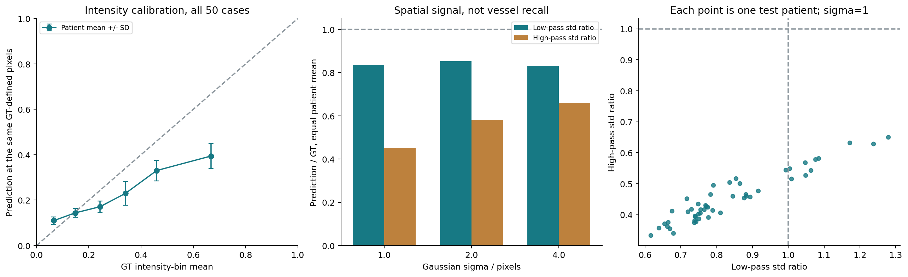
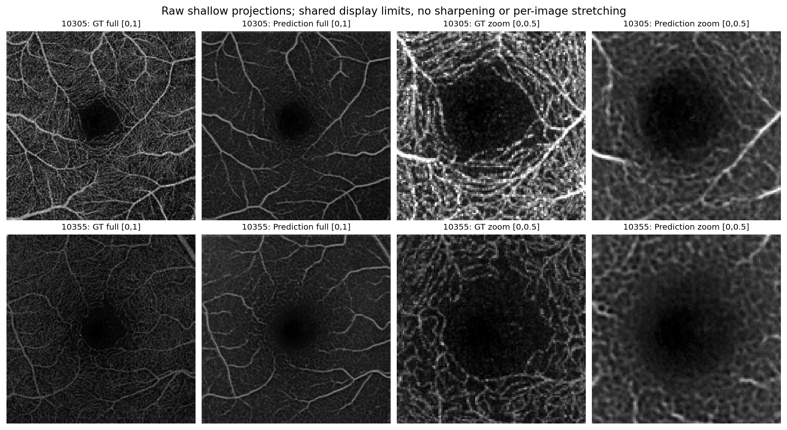

# FlowOCT：起点监督模型的50例测试与细结构分析

本项目整理当前 **3DFM + 50%精确起点监督** 模型的完整50例测试报告、全部病例图片、相关训练/推理代码，以及针对“主干清楚、细网偏弱、局部主干过亮”的补充分析。图片与代码已按用户明确授权公开，用于他人或AI审阅。

当前判断：**模型对大尺度血管走向的恢复好于细密纹理，同时存在病例和区域相关的强度偏差。** 起点监督改善了从纯OCT出发的预测，但没有给细血管增加专门监督，也没有增加新的血流观测信息。

## 直接阅读

- [细结构与亮度分层：补充分析](report/vessel_scale_analysis.md)：解释依据、最新定量结果与解释边界。
- [50例测试集完整图文报告](report/test50/test_analysis.md)：全部50例、5页总览、逐病例图、指标与来源。
- [原始HTML报告](report/test50/index.html)：保留完整版本；GitHub通常显示HTML源码，在线阅读请使用上面的Markdown报告。
- [如何把链接发给别人或AI](REVIEW_GUIDE.md)：审阅路径和可直接复制的分析请求。
- [复算方法与代码说明](REPRODUCE.md)：只复算已保存的二维结果，不重新生成或训练模型。

## 固定模型和数据

| 项目 | 内容 |
| --- | --- |
| 来源 | exp001训练；exp010完整测试；本项目为新的exp012事后分析 |
| 划分 | 140训练 / 10验证 / 50测试，患者不跨组 |
| 训练 | 100轮 × 200次成功更新；每轮一半精确t=0、一半随机时间；CUDA AMP |
| 模型 | 体素3D U-Net，基础通道16，约210万参数，OCT条件 |
| 损失 | 速度MSE；没有投影、细血管分割或拓扑损失 |
| 权重 | 验证集已选定的第70轮，未根据这50例测试重新选模 |
| 推理 | FP32、关闭TF32、Euler8、256×64×64滑窗、50%重叠、逐步Hann融合速度 |
| 测试结果 | 体积MAE 0.015458；PSNR 29.971 dB；浅层SSIM 0.4074；PCC 0.6595 |

## 新增的可复算证据

对全部50例保存的原始浅层投影，按固定规则作事后诊断：

- Gaussian σ=1像素时，预测/GT的低频标准差比均值 **0.835**，高频标准差比均值 **0.453**；50/50例高频标准差比小于1。
- GT处于[0,0.1)的像素，患者等权GT均值 **0.0659**，预测 **0.1098**；GT处于[0.6,1]的像素，GT **0.6677**，预测 **0.3943**。
- 原50例结果中，浅层投影均值有8例高于GT、42例不高于GT，符合强度偏差随病例改变的现象。

这里的“高频”同时包含细血管、纹理和噪声；“强度分区”也不等于血管口径分组。**0.453不是细血管召回率或真实细血管保留率。** 上述统计支持平滑和对比度压缩的现象，不能单独证明其训练原因。





## 内容与运行

```text
report/test50/       原完整报告及全部58张原图，逐文件保留
report/             新补充分析、两张新图、逐病例分区/尺度CSV
derived/ilm_opl/     50对原始浮点浅层投影，只包含GT和预测
source/training/    exp001训练代码和配置副本
source/evaluation/  exp010推理/评价代码、配置与科学核对记录副本
analyze_scales.py   新增二维事后诊断入口
verification/       原文件指纹、二维数据来源与分享完整性检查
```

```bash
python -m pip install -r requirements.txt
python analyze_scales.py
python verify_share.py
```

分析入口不需要PyTorch、GPU或原始三维数据。本仓库未附模型权重、原始三维OCT/OCTA、服务器凭据或交付压缩包。完整重新训练/推理需要另行准备合法数据和对应权重，见[复算说明](REPRODUCE.md)。

测试集只用于固定模型的评价与本次明确标注的事后描述，不用于训练、冒烟检查、超参数选择或检查点选择。项目历史上已有其他模型评价过同一测试划分，因此不称为全项目从未接触的外部盲测。

理论来源、方法局限和后续验证方向见[补充分析](report/vessel_scale_analysis.md)；资料来源见[NOTICE](NOTICE.md)。
