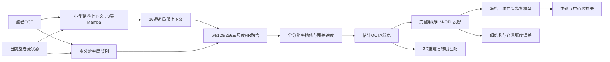

# LocalVessel-HRFM：面向局部微血管的3D流匹配

本项目是重新独立实现的 **exp176_20261116_localvessel_hrfm_200e**。研究问题来自用户对细血管恢复的关注；设计与实现没有读取或复制当前项目的旧实验源码。它融合两条主线：持续保持高分辨率的局部多尺度网络，以及直接作用于生成图像的血管监督。

**状态：科研代码已实现并进行CPU工程验证；尚未绑定实际数据、启动A100训练或取得新实验效果。** 不把可运行、参数量或工程测试当作微血管恢复已改善的证据。

## 入口

- [完整研究协议与公式](docs/PROTOCOL.md)
- [OCTA-500标注核查与数据适配](docs/DATASET.md)
- [固定划分与输入清单格式](docs/manifest_schema.md)
- [逐项来源、原实现及改动](docs/PROVENANCE.md)
- [供他人/AI继续分析的问题](REVIEW_GUIDE.md)
- [验证记录](verification/README.md)

## 网络重心

| 部分 | 设置 | 实测参数 |
| --- | --- | ---: |
| 生成器 | 全分辨率局部分支＋轻量全局上下文 | 27,421,329 |
| 局部与时间模块 | 三个并行尺度64/128/256，3次融合，每次每尺度2块；原分辨率再4块精修 | 26,876,225，98.01% |
| 全局上下文 | 全卷32×38×38，96宽，3个轴向双向Mamba块，压缩为16通道上下文 | 545,104，1.99% |
| 其中Mamba算子 | 官方Mamba v1，state16、expand2、conv4、rank6；Z/Y/X各一块、正反共享权重 | 204,480，0.75% |
| 冻结二维血管监督模型 | 全分辨率32宽、6残差块，无下采样，背景/毛细/大血管三类 | 111,779，单独统计 |

局部主干的最高分辨率分支始终存在，不先把微小结构压入低分辨率瓶颈再恢复。每块包含3³、3×5×5、横向空洞3³的深度卷积分支、融合、普通3³空间卷积和通道MLP；逐体素LayerNorm、时间shift/scale和残差。低分辨率局部支路与高分辨率支路反复交换特征。



不使用Haar；生成器在原体素坐标预测速度。小型Mamba只提供整卷上下文，局部图像生成与大多数参数由CNN承担。当前核与空洞率以体素为单位，不宣称已按未知的物理间距优化。

## 为什么血管损失约束的是生成结果

先用训练集GT OCTA的ILM–OPL最大投影及OCTA-500对应标签训练一个小型二维血管模型，并按验证规则选定、冻结。流训练时把生成OCTA的可微投影送入该冻结模型，梯度经过它回到生成图像。

生成器没有独立的分割输出头来代替生成任务交差。血管类别损失、细中心线加权重建、soft-clDice、背景与FAZ约束共同生效；三维梯度匹配比较的是预测与GT梯度，不使用会直接抹平细节的普通TV惩罚。

冻结模型仍可能有偏差或被生成器利用，所以另有直接图像重建损失，选模也使用生成图像本身在毛细血管、中心线、背景、大血管及体积中的误差。基于同一冻结模型得到的分割指标明确标为相关诊断，不能冒充独立临床验证。

## OCTA-500的边界

论文介绍了毛细血管等投影标注。毛细血管标签包含人工小图标注、模型推广和拓扑优化过程，不能称为完整人工三维血管真值。这里将其用于匹配的二维ILM–OPL投影；绝不沿Z简单拉伸成三维血管标签。

处理后物理间距目前未知，默认配置保留null。管径分组叫**表观像素宽度**，由图像标签与距离变换得到，不等于真实生理管径。只读目录盘点已确认用户下载中GT_Capillary、GT_LargeVessel、GT_FAZ等目录各500文件；具体版本、编码、朝向与3M固定成员的匹配仍待绑定核验。没有可用真实标签时会停止，不自动制造伪真值。

## 默认训练清单

| 项目 | 预先声明 |
| --- | --- |
| 数据 | 导入用户现有固定140/10/50划分；不重新随机划分；正式绑定时锁定清单和输入指纹 |
| 分辨率 | 预处理ZYX=256×304×304，强度除255；不横向缩小标签或图像 |
| 裁块 | 全深度核心256×96×96，横向halo32；实际输入256×160×160，保持完整投影射线 |
| 每患者 | 一个按有效体素数抽样的均匀分区＋一个GT结构均衡裁块 |
| 结构采样 | 50%细中心线、20%FAZ周边、15%其他血管、15%背景；类别缺失时仅在可用类别内归一化 |
| 有效batch | 每更新2患者；逐患者处理，每患者2裁块；两患者完成后统一clip/step/EMA |
| 轮次 | 自然患者遍历200轮，每轮70更新，共14,000次成功更新、28,000患者访问、56,000裁块 |
| 时间 | 每轮35/140患者精确t=0，其余U(0,1)；同患者两裁块共享同一整卷状态与时刻 |
| 优化器 | AdamW，betas(.9,.999)、eps1e-8、wd.01；bias/norm/官方特殊标记不衰减；clip1 |
| LR | 700更新热身到1e-4，再余弦至1e-5；EMA .999 |
| 监督模型 | 独立3000更新、batch8、128²裁块；AdamW 3e-4余弦；每250更新验证，按毛细/大血管平均Dice选定 |
| 精度 | 网络BF16 autocast；参数、AdamW、EMA、轨迹和损失float32；TF32均开，benchmark开，deterministic关，无scaler |
| 验证 | 每5轮固定10人整卷；同一个EMA检查点计算全部标准与额外诊断指标 |
| 原选模 | 最小化患者宏平均：.4毛细MIP MAE＋.2毛细中心线MIP MAE＋.2背景MIP MAE＋.1大血管MIP MAE＋.1体积MAE |
| 推理 | Heun16；每次速度评估使用同一全卷状态与全局上下文，再融合全部局部速度；不独立积分各patch |
| 推理核心 | 256×128×128，横向重叠32、halo32；有效Hann权重与完整覆盖检查 |
| 留存 | 每20完整更新、完整轮和暂停保存latest；独立best；验证留指标与二维图，正式测试保留三维预测 |
| 测试 | 完成200轮及最终验证并冻结原best之后，固定50人；可在病例边界继续 |

预算、通道和损失是本项目设计选择，尚无证据保证最佳或必然优于旧实验。局部全分辨率卷积也可能较贵，不承诺未经A100实测的速度或显存。

## 使用

公开审阅分支的获取方式：

```bash
git clone --single-branch --branch exp176-localvessel-hrfm-review-20261117 --depth 1 https://github.com/yuehanghahaha/flowoct-start-supervision-review.git
cd flowoct-start-supervision-review
python verify_release.py
```

先阅读数据与协议文档。已有环境优先，本仓库不自动安装、升级或创建Conda环境。CPU检查不需要mamba-ssm；正式GPU阶段直接使用官方算子，禁止悄悄替换成CPU参考实现。

```bash
python run.py info
python -m unittest tests.test_project -v

# 仅CPU数据准备：必须指向已有固定划分清单。
python run.py prepare --manifest /YOUR_HOME/fixed_manifest.csv --run /YOUR_HOME/experience/exp176/run

# 检查annotation_audit中方向/层区/标签匹配后，在已获配的A100内执行：
# 先按下述HPC说明登记宿主机home与/workspace的设备/inode映射。
python run.py fit --manifest /YOUR_HOME/fixed_manifest.csv --run /YOUR_HOME/experience/exp176/run

# 安全暂停；fit再次调用会恢复已提交的阶段/更新，而非从头重跑。
python run.py pause --run /YOUR_HOME/experience/exp176/run
# 重新fit前移除自己创建的pause.request；manage.sh resume会替你完成。
```

fit依次完成监督模型、全尺寸GPU验收、正式生成器训练、验证选模、冻结测试及analysis_return导出。验收使用训练患者，5次预热＋20次计时，并检查完整分辨率生成；失败即退出，不自动缩小科学设置。正式模型从头初始化，不继承验收的诊断更新。

测试集不用于数据统计、预训练、性能调试、监督模型选择或生成器选模。正式test命令校验预算和冻结身份。输出直接同步目录，无默认ZIP/tar；下载analysis_return后用tools/verify_export.py核对。

HPC默认保护：用户自行申请GPU，先在宿主机核对自己的账号/home，并只对自己的home取得stat设备号与inode；经hpc-gpu enter进入已分配slot，再用tools/register_platform.py登记匹配值。正式CUDA工作在核验通过后才初始化。manage.sh复用既有lyh_flowoct和lyh_tmux，不代申请/释放资源，不改可见设备、不创建或修改环境。其他平台需要另行明确配置execution.require_hpc_container，不能用该选项绕过本用户服务器约束。

## 科学结论的边界

本项目的贡献假设是把持续高分辨率的局部建模，与作用于生成结果的毛细血管结构监督相结合。高频不等于血管，2D连通性不等于3D连通性，更多亮线不等于更多真实血流。OCT条件的信息本身也可能不足以唯一确定患者OCTA微血管。最终必须结合完整3D/逐B-scan/各投影指标、误检、连续性和独立视觉审阅判断，不能只看速度MSE或冻结监督模型的分数。
