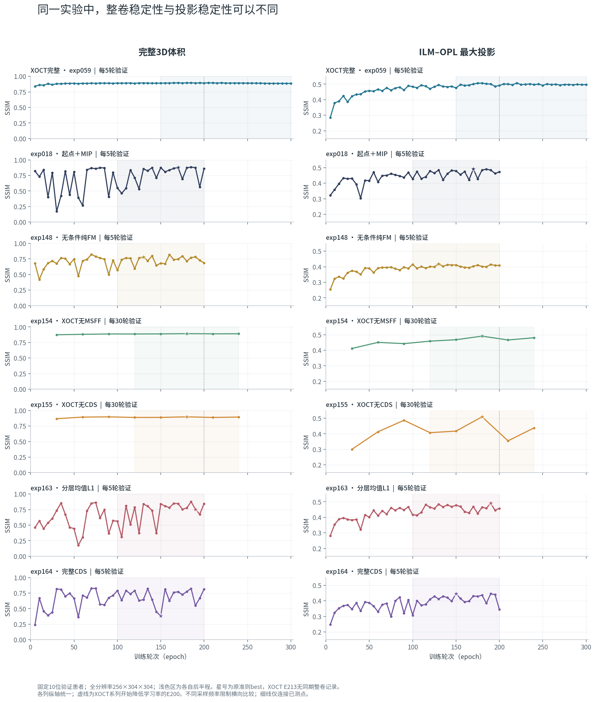

# 学习率与指标稳定性：8个主实验＋TransPro补充版本

2026年11月16日，exp173，仅分析既有训练与验证。

确实存在指标不稳，主要集中在几组3D流匹配的完整体积结果，以及XOCT无CDS组的浅层投影。现有记录支持把学习率列为排查项，尚不能认定它是主因。

## 后半程对照

| 实验 | 后半程 / 点数 | 3D SSIM范围 | 3D相邻平均变化 | 主投影SSIM范围 | 投影相邻平均变化 | 观察 |
| --- | --- | --- | --- | --- | --- | --- |
| XOCT完整 · exp059 | E155–300 / 30点 | 0.8863–0.8967 | 0.0013 | 0.4856–0.5066 | 0.0046 | 整卷与主投影较稳 |
| exp018 · 起点＋MIP | E105–200 / 20点 | 0.4616–0.8841 | 0.1337 | 0.4217–0.4925 | 0.0305 | 整卷明显跳动；投影也有波动 |
| exp148 · 无条件纯FM | E105–200 / 20点 | 0.5954–0.8206 | 0.0671 | 0.3895–0.4187 | 0.0078 | 投影较稳，整卷仍有跳动 |
| exp154 · XOCT无MSFF | E150–240 / 4点 | 0.8883–0.8918 | 0.0024 | 0.4661–0.4908 | 0.0207 | 已观测点较稳；记录稀疏 |
| exp155 · XOCT无CDS | E150–240 / 4点 | 0.8874–0.8978 | 0.0088 | 0.3547–0.5093 | 0.1099 | 整卷较稳；主投影明显波动 |
| exp163 · 分层均值L1 | E105–200 / 20点 | 0.3088–0.8761 | 0.1904 | 0.4137–0.4904 | 0.0231 | 整卷明显跳动；投影不能代表整卷 |
| exp164 · 完整CDS | E105–200 / 20点 | 0.3819–0.8231 | 0.1313 | 0.3448–0.4468 | 0.0272 | 整卷与主投影均有明显波动 |

## 明确回落与逐患者核对

| 实验 | 对象 | 轮次 | SSIM变化 | 下降量 | SSIM下降人数 | MAE变差人数 | 实际LR |
| --- | --- | --- | --- | --- | --- | --- | --- |
| exp018 | 完整3D体积 | E190→E195 | 0.874736→0.564963 | -0.309773 | 10/10 | 10/10 | 0.0002 |
| exp148 | 完整3D体积 | E115→E120 | 0.759657→0.595445 | -0.164212 | 9/10 | 10/10 | 0.0002 |
| exp163 | 完整3D体积 | E120→E125 | 0.788157→0.370369 | -0.417788 | 10/10 | 10/10 | 0.0002 |
| exp164 | 完整3D体积 | E185→E190 | 0.823110→0.548255 | -0.274855 | 10/10 | 10/10 | 0.0002 |
| exp155 | 主ILM–OPL最大投影 | E180→E210 | 0.509291→0.354735 | -0.154556 | 10/10 | 10/10 | 8.9108911e-05 |

## 学习率能解释多少

“指标不稳与学习率有关”是合理候选解释。学习率决定一次更新的尺度，PyTorch也提供验证停滞后降低学习率的机制；这不等于每次波动都由学习率过大引起。现有结果没有只改变学习率的配对对照，不能作因果结论。

四个FM实验全程2e-4，且后半程仍有明显整卷起伏，值得检查学习率。但相同2e-4下，exp148浅层投影相邻变化仅0.0078，exp018为0.0305；采样、条件、损失与BF16等同时不同。相同标量学习率也不代表不同优化器/网络具有相同有效步长。

exp155在E180→E210的主投影SSIM从0.509291降到0.354735，10/10患者同向变差；此时学习率已从1e-4降到8.91e-5。下降中的学习率仍会伴随大幅回落，因此不能把稳定性当作学习率曲线的直接结果。

XOCT中心裁块指标的相邻轮平均绝对变化从E151–199的0.009946降到E251–300的0.003747，与降学习率同向。后期训练成熟、GAN状态与学习率一起变化；两个时间窗口也不是同一实验时段，仍不能单独归因。

TransPro exp035实际200轮恒定2e-4。其配置/记录里的衰减不能当作已经作用于训练：首次低值0.0001980198是E200结束后留给E201的。exp040确实降低了学习率，但E101–200的原B-scan MAE仍有波动，且未超过E83的原MAE best；它还改变了教师模式、D缩放、验证流程等，不能用035/040差异估计LR效应。

exp164还有已记录的监督/梯度现象：精确t0分支训练中，CDS目标占主要损失数值，t0总梯度在所有20,000次更新都触发clip1。它说明优化受到多项设置共同影响；损失数值比不是分量梯度比，不能据此断定原因。

选模目标也会放大“投影看着最好、整卷却很差”的现象。exp164原best E150的验证3D SSIM仅0.381905，紧接E155为0.812230；E150依然因浅层投影SSIM0.446775入选。这是原规则的真实取舍，与是否存在学习率问题需分开解释。

[PyTorch学习率调整机制](https://docs.pytorch.org/docs/stable/generated/torch.optim.lr_scheduler.ReduceLROnPlateau.html)。

原随机裁块MAE：后半程范围 0.023479–0.025587，相邻平均绝对变化 0.000371。全程并非没有尖峰：E23→E24的MAE由0.036545升到0.048736，随后回落。后半程的小幅起伏不能反推前期同样稳定，也不能据此宣布其完整投影稳定。

补充exp040：原逐B-scan SSIM后半程范围 0.780430–0.846573，相邻平均绝对变化 0.012278。前半程E87→E88出现明显尖峰：原B-scan SSIM由0.805244降至0.197413，MAE由0.017410升至0.048974；当时LR仍为2e-4。这是原GT min–max、Gaussian11二维口径，不是3D SSIM。后期波动较小也不能仅归因于降LR，因为训练阶段同时改变。

## 完整三指标

每格为 MAE↓ / PSNR↑ / SSIM↑；验证best为主，最终轮为补充。

| 实验 | 检查点 | 完整3D | 主ILM–OPL最大投影 |
| --- | --- | --- | --- |
| XOCT完整 · exp059 | 原best E213 | 未取得该权重留存记录 | 未取得该权重留存记录 |
| XOCT完整 · exp059 | 最终轮（补充） E300 | 0.011158 / 29.712 / 0.886608 | 0.070736 / 20.620 / 0.496673 |
| exp018 · 起点＋MIP | 原best E170 | 0.010954 / 30.125 / 0.877257 | 0.065760 / 21.233 / 0.492494 |
| exp018 · 起点＋MIP | 最终轮（补充） E200 | 0.011725 / 30.450 / 0.861283 | 0.066510 / 21.090 / 0.473135 |
| exp148 · 无条件纯FM | 原best E130 | 0.014842 / 28.480 / 0.782501 | 0.075974 / 20.114 / 0.418736 |
| exp148 · 无条件纯FM | 最终轮（补充） E200 | 0.016625 / 28.811 / 0.687201 | 0.075114 / 20.193 / 0.408018 |
| exp154 · XOCT无MSFF | 原best E180 | 0.010672 / 30.030 / 0.891828 | 0.071845 / 20.506 / 0.490779 |
| exp154 · XOCT无MSFF | 最终轮（补充） E240 | 0.010928 / 29.837 / 0.890208 | 0.071990 / 20.474 / 0.480607 |
| exp155 · XOCT无CDS | 原best E180 | 0.010419 / 30.148 / 0.897817 | 0.072413 / 20.459 / 0.509291 |
| exp155 · XOCT无CDS | 最终轮（补充） E240 | 0.010224 / 30.256 / 0.893905 | 0.076980 / 19.322 / 0.437747 |
| exp163 · 分层均值L1 | 原best E190 | 0.014648 / 30.012 / 0.754466 | 0.064099 / 21.531 / 0.490427 |
| exp163 · 分层均值L1 | 最终轮（补充） E200 | 0.011723 / 30.066 / 0.845208 | 0.072537 / 20.433 / 0.457524 |
| exp164 · 完整CDS | 原best E150 | 0.024663 / 28.099 / 0.381905 | 0.073762 / 20.394 / 0.446775 |
| exp164 · 完整CDS | 最终轮（补充） E200 | 0.013478 / 29.291 / 0.814067 | 0.085980 / 19.135 / 0.344751 |

### 逐B-scan二维

| 实验 | 原best | 三指标 | 最终轮 | 三指标（补充） |
| --- | --- | --- | --- | --- |
| XOCT完整 · exp059 | E213 | 未取得该权重留存记录 | E300 | 未取得该权重留存记录 |
| exp018 · 起点＋MIP | E170 | 未取得该权重留存记录 | E200 | 未取得该权重留存记录 |
| exp148 · 无条件纯FM | E130 | 0.014842 / 28.551 / 0.779352 | E200 | 0.016625 / 28.890 / 0.684919 |
| exp154 · XOCT无MSFF | E180 | 0.010672 / 30.123 / 0.888033 | E240 | 0.010928 / 29.921 / 0.885406 |
| exp155 · XOCT无CDS | E180 | 0.010419 / 30.235 / 0.893455 | E240 | 0.010224 / 30.343 / 0.891147 |
| exp163 · 分层均值L1 | E190 | 0.014648 / 30.078 / 0.749608 | E200 | 0.011723 / 30.132 / 0.843530 |
| exp164 · 完整CDS | E150 | 0.024663 / 28.148 / 0.380012 | E200 | 0.013478 / 29.358 / 0.810584 |

### OPL–BM最大投影

| 实验 | 原best | 三指标 | 最终轮 | 三指标（补充） |
| --- | --- | --- | --- | --- |
| XOCT完整 · exp059 | E213 | 未取得该权重留存记录 | E300 | 0.069434 / 20.725 / 0.458287 |
| exp018 · 起点＋MIP | E170 | 0.067377 / 21.026 / 0.410351 | E200 | 0.066888 / 21.080 / 0.377466 |
| exp148 · 无条件纯FM | E130 | 0.091036 / 18.700 / 0.146005 | E200 | 0.084911 / 19.203 / 0.141522 |
| exp154 · XOCT无MSFF | E180 | 0.074660 / 20.026 / 0.440119 | E240 | 0.071481 / 20.433 / 0.442752 |
| exp155 · XOCT无CDS | E180 | 0.070843 / 20.569 / 0.467323 | E240 | 0.068644 / 20.757 / 0.460228 |
| exp163 · 分层均值L1 | E190 | 0.065598 / 21.381 / 0.428075 | E200 | 0.072079 / 20.451 / 0.393218 |
| exp164 · 完整CDS | E150 | 0.074176 / 20.176 / 0.392165 | E200 | 0.073233 / 20.329 / 0.349545 |

### 全深度均值投影

| 实验 | 原best | 三指标 | 最终轮 | 三指标（补充） |
| --- | --- | --- | --- | --- |
| XOCT完整 · exp059 | E213 | 未取得该权重留存记录 | E300 | 0.004717 / 44.358 / 0.962145 |
| exp018 · 起点＋MIP | E170 | 0.005732 / 43.031 / 0.946912 | E200 | 0.005547 / 43.343 / 0.950892 |
| exp148 · 无条件纯FM | E130 | 0.008394 / 40.471 / 0.907479 | E200 | 0.009369 / 40.048 / 0.896673 |
| exp154 · XOCT无MSFF | E180 | 0.004781 / 44.218 / 0.960838 | E240 | 0.004951 / 43.939 / 0.956849 |
| exp155 · XOCT无CDS | E180 | 0.005080 / 43.743 / 0.956457 | E240 | 0.004949 / 44.059 / 0.957021 |
| exp163 · 分层均值L1 | E190 | 0.007521 / 42.068 / 0.926051 | E200 | 0.006591 / 42.211 / 0.929135 |
| exp164 · 完整CDS | E150 | 0.013867 / 37.167 / 0.850916 | E200 | 0.006132 / 42.496 / 0.939771 |

### 全深度最大投影

| 实验 | 原best | 三指标 | 最终轮 | 三指标（补充） |
| --- | --- | --- | --- | --- |
| XOCT完整 · exp059 | E213 | 未取得该权重留存记录 | E300 | 未取得该权重留存记录 |
| exp018 · 起点＋MIP | E170 | 0.079194 / 20.123 / 0.359783 | E200 | 0.088521 / 19.434 / 0.352136 |
| exp148 · 无条件纯FM | E130 | 0.081530 / 19.779 / 0.278605 | E200 | 0.082854 / 19.656 / 0.291413 |
| exp154 · XOCT无MSFF | E180 | 0.076758 / 20.180 / 0.356643 | E240 | 0.076441 / 20.214 / 0.349106 |
| exp155 · XOCT无CDS | E180 | 0.075337 / 20.376 / 0.366486 | E240 | 0.084027 / 19.059 / 0.278633 |
| exp163 · 分层均值L1 | E190 | 0.075672 / 20.442 / 0.362306 | E200 | 0.091848 / 19.129 / 0.350464 |
| exp164 · 完整CDS | E150 | 0.080268 / 19.908 / 0.328398 | E200 | 0.093133 / 19.001 / 0.281829 |

### ILM–OPL层内均值

| 实验 | 原best | 三指标 | 最终轮 | 三指标（补充） |
| --- | --- | --- | --- | --- |
| XOCT完整 · exp059 | E213 | 未取得该权重留存记录 | E300 | 0.025540 / 29.451 / 0.705138 |
| exp018 · 起点＋MIP | E170 | 未取得该权重留存记录 | E200 | 未取得该权重留存记录 |
| exp148 · 无条件纯FM | E130 | 0.031788 / 27.787 / 0.605465 | E200 | 0.031028 / 28.056 / 0.612854 |
| exp154 · XOCT无MSFF | E180 | 0.026089 / 29.256 / 0.694064 | E240 | 0.026010 / 29.277 / 0.693293 |
| exp155 · XOCT无CDS | E180 | 0.026324 / 29.113 / 0.687862 | E240 | 0.025072 / 29.563 / 0.703943 |
| exp163 · 分层均值L1 | E190 | 0.027754 / 29.162 / 0.684271 | E200 | 0.028488 / 28.685 / 0.655264 |
| exp164 · 完整CDS | E150 | 0.034060 / 27.609 / 0.626915 | E200 | 0.030380 / 28.076 / 0.619303 |

### OPL–BM层内均值

| 实验 | 原best | 三指标 | 最终轮 | 三指标（补充） |
| --- | --- | --- | --- | --- |
| XOCT完整 · exp059 | E213 | 未取得该权重留存记录 | E300 | 0.024129 / 29.938 / 0.684728 |
| exp018 · 起点＋MIP | E170 | 未取得该权重留存记录 | E200 | 未取得该权重留存记录 |
| exp148 · 无条件纯FM | E130 | 0.035631 / 27.016 / 0.428690 | E200 | 0.033690 / 27.506 / 0.429774 |
| exp154 · XOCT无MSFF | E180 | 0.023735 / 30.030 / 0.688512 | E240 | 0.023961 / 29.973 / 0.682497 |
| exp155 · XOCT无CDS | E180 | 0.024988 / 29.611 / 0.668790 | E240 | 0.023756 / 30.087 / 0.688073 |
| exp163 · 分层均值L1 | E190 | 0.025845 / 29.835 / 0.672105 | E200 | 0.026753 / 29.371 / 0.630782 |
| exp164 · 完整CDS | E150 | 0.027893 / 29.105 / 0.636216 | E200 | 0.026569 / 29.354 / 0.622576 |

### ILM–BM层内均值

| 实验 | 原best | 三指标 | 最终轮 | 三指标（补充） |
| --- | --- | --- | --- | --- |
| XOCT完整 · exp059 | E213 | 未取得该权重留存记录 | E300 | 0.020884 / 31.280 / 0.763125 |
| exp018 · 起点＋MIP | E170 | 未取得该权重留存记录 | E200 | 未取得该权重留存记录 |
| exp148 · 无条件纯FM | E130 | 0.029191 / 28.764 / 0.614674 | E200 | 0.028520 / 29.010 / 0.608266 |
| exp154 · XOCT无MSFF | E180 | 0.021189 / 31.132 / 0.756299 | E240 | 0.021160 / 31.132 / 0.755833 |
| exp155 · XOCT无CDS | E180 | 0.021921 / 30.840 / 0.748822 | E240 | 0.021033 / 31.224 / 0.760217 |
| exp163 · 分层均值L1 | E190 | 0.023566 / 30.757 / 0.743159 | E200 | 0.025231 / 30.069 / 0.704765 |
| exp164 · 完整CDS | E150 | 0.027304 / 29.675 / 0.702000 | E200 | 0.025568 / 29.777 / 0.681837 |

### TransPro原生逐B-scan协议

| 实验 | 原best | MAE / PSNR / SSIM | 口径 |
| --- | --- | --- | --- |
| TransPro · exp035 | E194 | 0.014184 / 28.768 / 0.837729 | 完整304张B-scan先卷内后患者平均；GT min–max，Gaussian11 |
| TransPro · exp040（补充） | E83 | 0.013357 / 28.417 / 0.840878 | 完整304张B-scan先卷内后患者平均；GT min–max，Gaussian11 |

固定/255、win7的完整3D与普通en-face投影三指标未取得，不用原生B-scan替代。八月版本逐轮历史缺失。

## 范围与口径

| 实验 | 完整预算 | 原best | 实际LR | 原准则 |
| --- | --- | --- | --- | --- |
| XOCT完整 · exp059 | 300×140 | E213 | 1e-4；E200起线性下降，E300=0 | 作者中心裁块三投影SSIM均值；仅E201–300准入 |
| TransPro · exp035 | 200×140 | E194 | 全部200轮固定2e-4 | 每轮原随机256³裁块MAE最低（G.train） |
| exp018 · 起点＋MIP | 200×200 | E170 | 固定2e-4 | 完整10人浅层MIP SSIM最高 |
| exp164 · 完整CDS | 200×200 | E150 | G固定2e-4；D固定1e-4 | 完整10人浅层MIP SSIM最高 |
| exp163 · 分层均值L1 | 200×200 | E190 | 固定2e-4 | 浅层MIP＋三张层均值SSIM等权平均最高 |
| exp155 · XOCT无CDS | 240×140 | E180 | 1e-4；E200起降至5.94e-5 | 完整10人浅层MIP SSIM最高 |
| exp154 · XOCT无MSFF | 240×140 | E180 | 1e-4；E200起降至5.94e-5 | 完整10人浅层MIP SSIM最高 |
| exp148 · 无条件纯FM | 200×200 | E130 | 固定2e-4 | 完整10人浅层MIP SSIM最高 |
| TransPro · exp040（补充） | 200×140 | E83 | 2e-4；E102起实际低于初值，E200=2e-6 | 原完整验证逐B-scan MAE最低 |

范围以2026年11月16日21:13前后的服务器只读快照冻结。按编号倒序筛选跑满原训练预算的科学实验：exp164、exp163、exp155、exp154、exp148。分析/测试编号不重复计入训练模型；exp156/159/161/162缺完成训练证据，exp168已停止，exp169/170/171/172在快照时未完成，均不凑入五个。八月TransPro没有完整逐轮历史，不能判断其训练稳定性。

统计描述训练过程中固定验证集的跨轮变化。未读取测试患者数组、未新增推理或训练，未用测试结果判断学习率、重选检查点或决定超参数。测试集一次评估中的患者标准差不能代替跨轮稳定性。

全程曲线保留原验证频率，后半程定义为epoch严格大于原预算的一半。相邻变化量为相邻已测点差的绝对值；并同时保留最大恶化、原始范围、去线性趋势残差标准差和符号翻转次数。原始范围可能包含改善趋势，不能单独当作噪声大小。没有套用通用“稳定/不稳”阈值，也没有对自相关轮次做独立样本显著性检验。

FM按共同E105–200、每5轮比较；XOCT与两组消融补充按共同E150/180/210/240比较，后者仅4点、3次变化。每30轮验证的平稳连线不能排除未采样时段的短时波动。学习率前后比较采用连续窗口，保留每个窗口的点数和真实LR；不把绝对LR与逐轮指标相关性当作因果检验。

标准组均使用完整256×304×304视野、10位固定验证患者、未量化float32预测、固定/255 GT和data_range=1。完整3D SSIM在三维计算；逐B-scan为每个Y位置的[Z,X]切片，304张先卷内再患者平均；PSNR也先分别评分再平均。标准SSIM为uniform win7、sample covariance，不能替代TransPro原Gaussian11结果。

主ILM–OPL投影为沿深度的层内最大值，补充对象分别为OPL–BM最大、全深度均值/最大及三种层内均值。XOCT来源的掩膜/层边界沿原实现，FM沿原native640中心映射和闭区间；其层边界并未在本次强行改写。各来源的窗口、融合、数值后端、训练协议不同，跨模型比较是描述性比较，不是单变量LR对照。

TransPro exp035每轮只有作者随机256³裁块、[-1,1]尺度MAE，且G在训练模式；不存在可据此替代的逐轮完整3D或浅层MIP三指标。exp040原记录为GT min–max归一化的逐B-scan评价，原SSIM数值除100显示；其MAE-V/PSNR-V/SSIM-V为血管加权协议，单独保留在native表，不充作普通en-face投影。该区分与TransPro论文§4.2一致。

所有主best均复核原准则：exp018 E170、exp148 E130、exp154/155 E180、exp163 E190、exp164 E150、exp035 E194、exp040 E83。XOCT以当前默认比较偏好展示作者原准入规则best E213；原交付主权重E300另作最终轮补充。XOCT完整验证仅每5轮，无E213同期标准整卷记录，本次不以E210/E215代替。

精度沿历史实际设置保留：exp018与XOCT系列为float32且TF32关闭；exp148为BF16 autocast、float32状态/损失、TF32允许、无scaler；exp163/164为float32、TF32允许、AMP/scaler关闭、benchmark开、deterministic关。近期TransPro035为float32、AMP/scaler关闭、matmul TF32关、cuDNN TF32开；exp040为另一明确调整的后端配置。历史标志以source协议和运行记录为准，没有重新标为统一严格FP32。

[TransPro论文§4.2](https://arxiv.org/html/2303.06807v2#S4.SS2)。

## 下一步

如果下一步专门验证学习率，优先在新的编号实验里做一个配对对照：保持exp018或其明确选定的现行基线的网络、初始化、数据/裁块/时间序列、损失、精度、预算和原选模准则一致，仅改变预先声明的学习率日程。训练预算保持完整；固定验证集同时观察3D、B-scan及各投影三指标。具体日程应在实施前固定，现有结果不足以选出“最佳学习率”，也不能保证降低后指标一定改善。当前已交付/在跑实验保持原设置，本报告没有启动该对照。

完整长表、统计、原始出处和缺失记录见本实验data/、source/与verification/。
