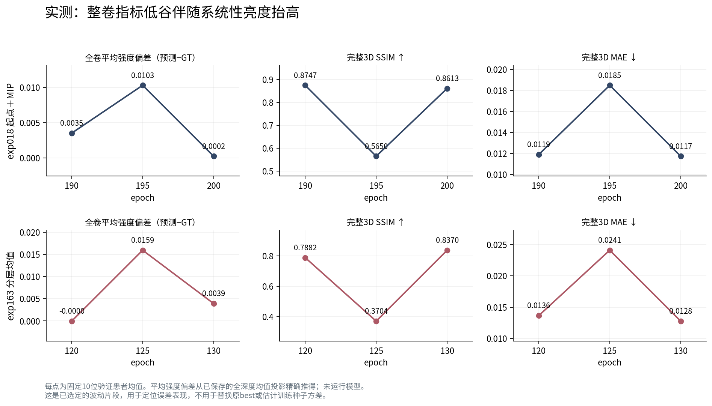
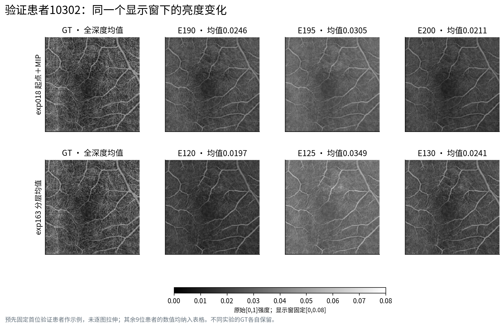

# 为什么XOCT稳定，而当前几组3D流匹配反复跳动？

2026年11月16日，exp174；父分析exp173。仅使用既有训练/验证，0轮新训练、0次新推理。未用测试集做学习率或训练方案决策。

**当前判断：已定位到“整卷强度随检查点系统性漂移”这个直接问题；最优先怀疑当前FM训练目标与实际八步生成终点之间约束不足。学习率可能放大敏感性；exp164还叠加了有实证的梯度尺度问题。** 这比把所有起伏归为学习率更符合代码和现有数据，但上游优化机制还没有被单变量实验最终确认。

## 1. 直接问题已经测到：整卷强度抬高，并非只有SSIM一项变化

本次回取exp018的E190/195/200与exp163的E120/125/130，每轮10人，共60对已保存的二维全深度均值投影。利用全深度均值的线性性质，投影的全图有符号均值差就是原三维卷的全卷平均强度偏差；不需要重跑模型，也没有推断某个未保留的三维细节。

下面每组三指标均为 **MAE↓ / PSNR↑ / SSIM↑**，固定[0,1]量纲、同10位验证患者、原完整256×304×304结果：

| 实验 | 诊断轮次 | 全卷预测−GT平均偏差 | 完整3D三指标 | 主ILM–OPL最大投影三指标 | 全卷正偏差患者 |
| --- | --- | --- | --- | --- | --- |
| exp018 | E190 | +0.003494 | 0.011886 / 30.270 / 0.874736 | 0.064095 / 21.526 / 0.485108 | 6/10 |
| exp018 | E195 | +0.010274 | 0.018493 / 29.814 / 0.564963 | 0.064304 / 21.579 / 0.462483 | 10/10 |
| exp018 | E200 | +0.000226 | 0.011725 / 30.450 / 0.861283 | 0.066510 / 21.090 / 0.473135 | 4/10 |
| exp163 | E120 | -0.000041 | 0.013642 / 29.756 / 0.788157 | 0.068292 / 20.870 / 0.464880 | 4/10 |
| exp163 | E125 | +0.015944 | 0.024092 / 29.006 / 0.370369 | 0.066050 / 21.330 / 0.456434 | 10/10 |
| exp163 | E130 | +0.003917 | 0.012760 / 29.862 / 0.837036 | 0.065720 / 21.322 / 0.484408 | 8/10 |

exp163 E120→E125，平均偏差从-0.000041变成+0.015944，10/10患者的平均强度都向上移动。与此同时，3D SSIM从0.788157降至0.370369、MAE从0.013642升到0.024092；主投影SSIM只从0.464880变为0.456434。E130平均偏差减小，3D指标恢复。

这次抬高覆盖很广：逐患者统计再平均，exp163有99.96%的横向位置，其沿深度平均后的预测高于E120；exp018 E190→E195对应比例为98.37%。这不是由少数明亮血管位置单独带来的均值移动，但仍不能据二维均值唯一还原每个深度体素。

exp018 E190→E195出现相同方向的现象；到E200偏差接近0，3D指标恢复。两组的训练数值精度不同，而相似表现都存在。

这里证实的是全卷强度漂移。全深度投影不能定位每个体素的深度，尚不能把“这些坏轮次的误差主要位于视网膜外背景”当成本次实测结论。也不能从平均偏差证明整幅误差都是一个相同常数。

## 2. 为什么SSIM掉得特别多？低信号窗口的亮度项会放大这种变化

SSIM同时比较局部亮度、对比度和结构，不是只评估血管轮廓。对于真实值全0、预测为常数b的均匀窗口，当前range1、K1=0.01设置下，SSIM为0.0001/(b²+0.0001)：偏差0.01就得到0.5，偏差0.02得到0.2。这个例子已经用当前同口径函数核对；它是说明机制的合成例子，不是把患者整卷当成常数图。

因此，少量绝对亮度漂移在低信号区域可能造成很大的3D SSIM变化，而PSNR的变化相对小。实际MAE也同步变差，说明存在真实预测误差。指标对误差的敏感性放大了曲线幅度，不能据此宣称整个血管结构每次都完全坍塌，也不能把它当作纯粹显示噪声。[SSIM原论文](https://live.ece.utexas.edu/publications/2004/zwang_ssim_ieeeip2004.pdf)

## 3. 我最优先怀疑的上游机制：训练约束的是速度/一步估计，验证的是八步自由生成

代码中的训练状态为 `(1-t)*OCT+t*OCTA`，网络预测速度，主项拟合 `OCTA-OCT`。随机时间的训练输入含有构造路径上的真实OCTA成分。推理则从OCT出发，每一步都接收网络自己生成的状态，按原Euler8连续推进。

**FM并非没有三维监督。** 精确t0时，速度MSE在代数上等价于监督一步估计`OCT+v`的完整三维MSE。exp018已有这一约束，不能把它误述成“只有投影监督”。真正的差别是：这个一步估计，以及真实插值路径上的速度，都不是实际八步自由生成的终点；这些实验没有把该八步终点直接放回训练目标。

这一机制与训练记录一致：exp163 E120→E125的训练平均FM MSE从约0.000729略降至0.000702，平均总梯度范数从0.582降至0.532，验证3D SSIM却由0.788降到0.370。训练平均速度损失没有对这次自由生成退化发出同方向信号。不同轮的训练裁块/时间样本也不同，这不是在相同训练样本上验证过的泛化定理，只说明该训练均值不能充当实际整卷质量的可靠代理。

对带独立OCT条件的线性配对路径，t>0时`(x_t-OCT)/t`在代数上就等于目标速度。因此存在利用训练混合状态信息的可行捷径；现有记录没有证明网络实际学了该公式。exp148去掉条件后投影更稳，但整卷仍会波动，也说明“额外OCT条件是唯一原因”不足以解释全部现象。

速度误差在生成轨迹中可能积累、被状态反馈放大，也可能部分抵消；不能说八步一定把误差放大八倍，更不能把8步本身判为错误。需要区分一步终点偏差、学习到的速度场偏差和求解器离散误差。[Flow Matching原论文](https://arxiv.org/abs/2210.02747)提供速度回归与ODE生成的基本框架；上述本项目机制判断来自实际代码与验证，是推断。

## 4. 为什么XOCT更稳？它对实际三维输出的监督更直接

XOCT每次直接输出OCTA三维裁块，对这个输出施加3D L1×10与3D对抗约束，并同时施加分层投影CDS。验证用的是同一直接生成器，不需要八次速度状态推进。输出经tanh界定范围，但“有tanh”本身也不是稳定性的证明。

该结构让全卷亮度/背景偏差在每次训练更新中直接受到三维重建目标惩罚。当前FM的主训练约束与实际八步生成之间则多了一层需要检验的关系。再加上网络容量、优化器动量、裁块等差异，**“直接输出＋直接三维监督＋当前优化配置的组合更稳”是有依据的解释；不能从这些历史组证明其中某一项单独决定了稳定性。**

XOCT在学习率仍固定1e-4的E105–E195，3D SSIM范围已经只有0.886997–0.895660。所以它的稳定不能仅用E200后的学习率衰减解释。无MSFF组exp154的已测整卷点也较稳，说明MSFF不是这一稳定性的必要条件；它仍比FM宽得多，不能据此排除模型容量因素。

## 5. exp164还有一个更直接的特有问题：CDS与FM的优化尺度失配

原训练后50轮、逐时间分支的参数总梯度实测为：

| 分支 | 更新次数 | FM MSE | 裁剪前G总梯度范数均值 | 触发clip1比例 |
| --- | --- | --- | --- | --- |
| t0 | 5000 | 0.001883 | 76.740097 | 100.0% |
| random | 5000 | 0.000518 | 0.055373 | 0.0% |

CDS只在精确t0分支施加，t0总梯度始终被裁剪；random分支的梯度小得多。正式训练前留存的单个初始化训练裁块，CDS对速度输出的梯度RMS约为FM的865.8倍（输出空间，不能冒充参数梯度比或全程占比）。这个结果提示：把XOCT的10/1/1数值直接接到当前FM上，并不保持相同优化强度。

全局梯度裁剪会缩放总梯度，不会自动把不同损失的方向和相对强度调平。仅调低总学习率会同时缩小各分支，未必解决目标之间的尺度关系。当前有证据优先检查exp164的监督尺度；并未通过现有记录分离CDS各组件的参数梯度贡献，不能断言哪一项单独导致某次回落。

exp018未加完整CDS也已出现波动，所以CDS不能解释所有FM组；它是exp164叠加的问题。

## 6. 学习率、选模与其他因素分别处于什么位置？

- **学习率：仍值得验证，但目前应列为可能的放大因素。** FM几组全程固定2e-4，相比XOCT的1e-4更大；不同优化器、动量和网络下这个数值不能直接等同有效更新大小。exp155在降低学习率时投影仍大幅回落，也反映稳定性受训练目标和模型状态共同影响。现有证据不足以指定一个“正确学习率”。
- **选模：解释交付权重为何可能整卷很差，不解释训练曲线为何跳动。** exp164 E150按浅层投影选中，验证3D SSIM为0.381905；E155为0.812230。这是原投影选模目标与整卷质量的取舍，原best继续保留，本次未重选。
- **数值后端：不优先视作共同主因。** 严格关闭TF32的exp018同样波动，后来的TF32/其他精度设置也波动。没有单独控制的对照，不能排除数值因素，但不能用它统一解释。
- **验证随机性/BN：当前共性代码不支持它作为首要解释。** FM生成器用GroupNorm，没有Dropout/BatchNorm；推理进入eval，从固定OCT开始，没有随机起点。病例、GT投影和range1在本次60对证据中一致。没有因此宣称全部实现细节都已无误。

## 7. 最有信息量的下一步

先固定现有好/坏检查点，在固定验证患者上比较一步估计与原8步输出，并记录每一步的均值、低信号误差与完整指标。它能区分“一步就偏”与“连续推进后才漂”。再用同一权重增加积分步数，可进一步区分离散误差和学到的速度场问题；不能预先认定增加步数一定改善。这个阶段不需要先重训。

若八步轨迹本身明显漂移，之后的新编号训练再分别检验实际生成终点约束与学习率日程；若一步已经同样跳动，则优先核查终点学习、损失/梯度平衡和优化步长。exp164的CDS尺度需独立控制。不能同时改很多项后把改善归因于学习率。本次只完成分析，没有执行上述新推理/训练，没有修改已交付或在跑实验。

## 证据与适用范围

- 60对原验证二维投影，GT跨轮不变，重新核对MAE/SSIM与原记录；有符号偏差按均值线性恒等式计算。没有打开三维预测或测试影像。
- 六个诊断轮次用于机制定位，不替代各实验的原best。完整原best/最终轮、九类对象及MAE/PSNR/SSIM缺口沿exp173保留。
- `data/validation_intensity_by_patient.csv`、`data/validation_intensity_summary.csv`：逐患者与逐轮强度/完整3D/主投影三指标。
- `data/paired_projection_changes.csv`：相邻诊断轮次逐患者强度移动。
- `data/selected_complete_standard_metrics.csv`：这些轮次已有的3D、逐B-scan、主及补充投影完整三指标。exp018缺逐B-scan和新增层均值组，未补造。
- `source/prior_analysis/validation_metrics.csv`：前次全部标准逐轮指标；`source/prior_analysis/learning_rates.csv`保留实际LR。
- `data/descriptive_correlations.csv`只描述既有E105–200关联，不能据相关系数认定因果或已解释某一百分比误差。
- `provenance.json`为来源与哈希，`verification/numerical_audit.json`为数值核验。A800可选的其他组二维回取超时，没有使用那次失败回取的数据，不影响已取得的exp018/163证据。

源码快照：[exp018训练](../source/code/exp018/run.py)、[FM原推理](../source/code/exp018/fm3d/inference.py)、[exp163目标](../source/code/exp163/method.py)、[exp164目标](../source/code/exp164/method.py)、[XOCT目标](../source/code/exp059/author/models/XOCT_model.py)。
