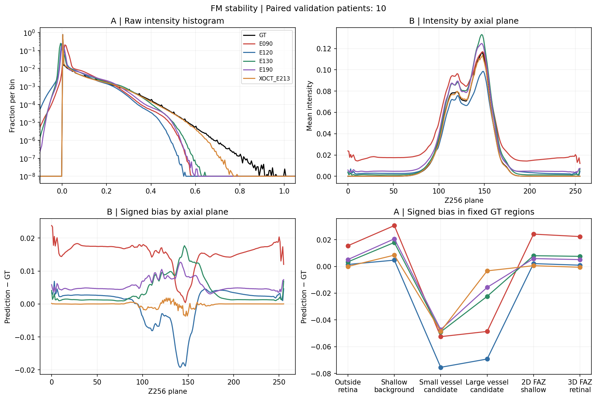
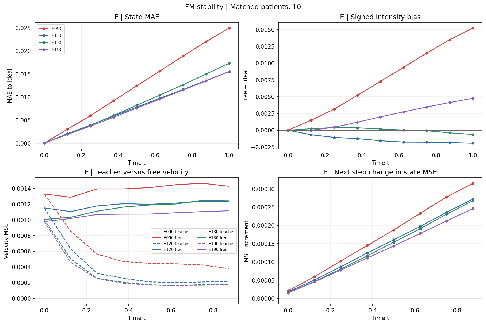

# A–F完成后的判断

数据截至2026-11-17T19:23:48.758366+08:00，固定10位验证患者，4个exp163权重与XOCT E213共50个模型病例。
E90替代未留存的E125作为低谷诊断。E190与XOCT E213保留原选模身份。

**核心判断：exp163低谷的主要直接机制是大范围背景信号抬高和强度分布失准；已学速度场在理想路径上就带有亮度正偏，自由生成持续累积偏差；血管细节不足在各权重间持续存在。**

### 1. A–D把E90低谷定位到强度尺度

E90完整3D SSIM为0.364562，全局均值校正为0.781274，均值和方差校正为0.849173，逐深度均值校正为0.834953。均值和方差校正在10/10患者改善SSIM，平均MAE降低49.2%。所有校正使用对应病例GT，只用于量化强度贡献。

### 2. A–C显示背景抬高与血管信号不足同时出现

E90全卷均值0.036574，GT为0.021220，偏高72.4%。GT分层定义的ILM–BM之外平均偏差+0.015460，浅层GT无血管射线+0.030524，FAZ3D层内+0.022305。这三个区域在全部10位患者均为正偏。
ILM–BM层带之外占全卷约83.3%体素，贡献E90绝对误差的66.5%（先各病例算占比，再患者等权）。
固定GT小管径候选体素偏差-0.052524，大管径候选体素-0.048640。表现为低信号区域变亮、血管对比度压缩。候选体素来自GT二维血管管径分区及层内半峰值条件，区域定义全程固定。

### 3. E显示漂移从第一步连续积累

E90在t=.125、.5、1的平均有符号偏差分别为+0.001488、+0.007280、+0.015213。十位患者均从第一步出现正偏。同时间理想路径MAE及MSE沿八步持续增加。

### 4. F显示理想路径已有偏置，轨迹反馈继续加重

E90在八个理想状态节点的速度均值误差均为正，覆盖10/10患者。将这些teacher速度偏差按Euler8时间间隔相加为+0.013667，实际自由轨迹终点偏差为+0.015213。主亮度偏置在理想输入上已经存在，自由状态反馈继续增加偏移。
40条FM自由轨迹的每一步状态MSE均增加。在第1–7个非零误差节点，误差与速度误差的整卷内积均为正，实际轨迹上的净作用是强化已有偏离。
末次节点t=.875的free/teacher速度MSE比，E90、E120、E130、E190分别为3.75、5.68、7.11、6.28。较好的检查点同样存在训练路径与自由路径差距。决定E90低谷的额外特征是持续正偏及广泛背景信号抬高。

### 5. 高3D指标还需要结合截断前状态和血管细节

E120、E130的截断前负值体素占比分别为35.7%、57.7%，这些值在原终点clamp操作后归零。零附近的强度分布、正负误差方向和截断共同决定3D SSIM表现。
XOCT的ILM–BM层带外偏差接近零，E90则有系统性正偏。各模型在固定GT小管径候选体素上仍有负偏，微血管恢复继续需要单独评价。

### 完整标准指标

每格均为MAE↓ / PSNR↑ / SSIM↑，患者等权。float32，固定/255、range1，3D SSIM三维，逐B-scan与投影SSIM二维，uniform win7 sample covariance。主投影为ILM–OPL最大，层带均值、深层和全Z投影分别列示。

| 权重 | 完整3D | 逐B-scan二维 | 主ILM–OPL最大 |
|---|---|---|---|
| E090 | 0.024818 / 28.887 / 0.364562 | 0.024818 / 28.927 / 0.362321 | 0.066784 / 21.286 / 0.447415 |
| E120 | 0.013642 / 29.756 / 0.788157 | 0.013642 / 29.813 / 0.784905 | 0.068292 / 20.870 / 0.464880 |
| E130 | 0.012760 / 29.862 / 0.837036 | 0.012760 / 29.926 / 0.832970 | 0.065720 / 21.322 / 0.484407 |
| E190 | 0.014648 / 30.012 / 0.754466 | 0.014648 / 30.078 / 0.749608 | 0.064100 / 21.531 / 0.490425 |
| XOCT_E213 | 0.010676 / 30.007 / 0.897296 | 0.010676 / 30.096 / 0.892069 | 0.072123 / 20.488 / 0.512805 |

| 权重 | OPL–BM最大 | 全Z均值 | 全Z最大 | ILM–OPL均值 | OPL–BM均值 | ILM–BM均值 |
|---|---|---|---|---|---|---|
| E090 | 0.068983 / 20.902 / 0.371279 | 0.015561 / 36.251 / 0.829955 | 0.080145 / 20.006 / 0.338775 | 0.031773 / 28.420 / 0.647104 | 0.029662 / 29.007 / 0.625185 | 0.027519 / 29.855 / 0.702894 |
| E120 | 0.070368 / 20.578 / 0.384049 | 0.006172 / 42.642 / 0.940862 | 0.087035 / 19.442 / 0.340322 | 0.026538 / 29.136 / 0.673283 | 0.025392 / 29.649 / 0.651226 | 0.022891 / 30.634 / 0.729787 |
| E130 | 0.067453 / 21.122 / 0.416567 | 0.006689 / 42.701 / 0.935156 | 0.072713 / 20.851 / 0.348224 | 0.027386 / 29.170 / 0.680073 | 0.026897 / 29.488 / 0.657127 | 0.023598 / 30.705 / 0.738427 |
| E190 | 0.065598 / 21.381 / 0.428075 | 0.007521 / 42.068 / 0.926052 | 0.075672 / 20.442 / 0.362306 | 0.027754 / 29.162 / 0.684271 | 0.025845 / 29.835 / 0.672106 | 0.023566 / 30.757 / 0.743159 |
| XOCT_E213 | 0.071434 / 20.474 / 0.464440 | 0.004757 / 44.419 / 0.961111 | 0.072708 / 20.747 / 0.387382 | 0.025776 / 29.414 / 0.706691 | 0.023794 / 30.065 / 0.691179 | 0.021130 / 31.230 / 0.762239 |

### E90的GT校正完整指标

| 处理 | 完整3D | 逐B-scan二维 | 主ILM–OPL最大 |
|---|---|---|---|
| 原输出 | 0.024818 / 28.887 / 0.364562 | 0.024818 / 28.927 / 0.362321 | 0.066784 / 21.286 / 0.447415 |
| global_mean | 0.013655 / 30.002 / 0.781274 | 0.013655 / 30.065 / 0.777053 | 0.066713 / 21.108 / 0.447911 |
| mean_std | 0.012603 / 30.077 / 0.849173 | 0.012603 / 30.131 / 0.843098 | 0.063989 / 21.775 / 0.473965 |
| depth_mean | 0.012641 / 30.274 / 0.834953 | 0.012641 / 30.338 / 0.829684 | 0.065640 / 21.241 / 0.449094 |

其余补充投影的GT校正三指标在af_summary.json和per_patient_standard.csv中完整保留。

证据快照为source/af_core_records.json，含50条完成记录及原记录SHA256。独立复算与阶段CSV核对见verification/af_summary_audit.json。A–F说明本轮现有权重的强度和轨迹行为，优化器或损失改动的效果需由对应训练对照评价。
