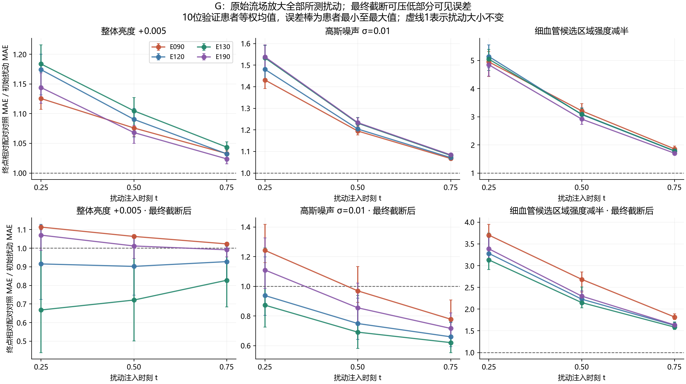
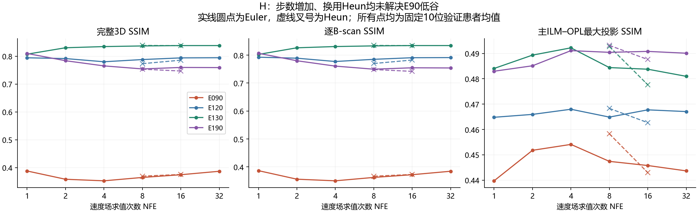

# exp182：G/H完整验证结果分析

分析与核对日期：2026年11月18日。实验建立/开始日期：2026年11月17日。
A800于2026年11月18日00:06:07完成，核心与扩展进程均正常退出。最终报告校验2,220份文件。
核心50/50、求解器320/320、扰动和无扰动对照840/840；G/H覆盖四个权重×固定十位验证患者。
本次只读取结果并进行CPU汇总，没有训练、重新推理或改变原检查点选择。

**结论：所测扰动会被已学习的速度场放大；步长离散误差不能解释E90的严重强度低谷。** 结合A–F，问题包含模型本身的强度偏差，以及沿自由轨迹继续传播、放大误差的能力缺陷。E130的高整卷SSIM没有消除这种缺陷，背景截断会影响其最终可见程度。

## G：模型会不会主动纠正扰动

起点为同一患者理想路径 $(1-t)X+tY$，t为0.25、0.5、0.75；加扰动与不加扰动各自继续剩余Euler8时间网格。本项不是在实际自由轨迹上注入，也不是以GT终点误差作为扰动幅度。比值分子为两条配对轨迹终点的MAE距离，分母为注入瞬间的MAE距离。
840项包含120条无扰动对照及720条实际注入。720/720条原始未截断终点的比值均大于1。全部实际注入的最小比值为1.013911，最大为5.559093。

下表每格为原始终点的**放大倍数**，依次为 t=0.25 / 0.5 / 0.75，均为十人等权平均。

| 权重 | 亮度+0.005 | 高斯噪声σ=0.01 | 细血管候选区域减半 |
|---|---:|---:|---:|
| E090 | 1.125 / 1.076 / 1.033 | 1.431 / 1.195 / 1.067 | 4.950 / 3.209 / 1.857 |
| E120 | 1.174 / 1.090 / 1.032 | 1.480 / 1.204 / 1.072 | 5.140 / 3.079 / 1.781 |
| E130 | 1.184 / 1.105 / 1.044 | 1.534 / 1.231 / 1.082 | 5.046 / 3.092 / 1.788 |
| E190 | 1.144 / 1.068 / 1.024 | 1.538 / 1.233 / 1.084 | 4.846 / 2.917 / 1.705 |

亮度的另外三档偏移（+0.01、+0.02、−0.02）同样全部被放大，详见[全部72组扰动汇总](recovery_groups.csv)。早期扰动经历更多剩余步骤，放大更明显。E130的原整卷SSIM为0.8370，但其早期亮度偏移放大1.184倍、高斯噪声1.534倍、细血管候选区域扰动5.046倍，表明高整卷分数不能代表误差收缩能力。

**最终截断需要单独看。** 以上结论来自未截断流场。将终点截断到[0,1]后，部分噪声和亮度扰动的可见比值小于1；例如E130晚期高斯噪声的均值为0.621。不能把这种结果直接归为网络主动恢复，截断本身会压掉负值。但细血管候选区域扰动的120/120次在最终截断后仍然放大。其整卷MAE距离包含局部扰动后向其他体素传播的影响，5倍不等于血管强度下降5倍；t较早时被减半的理想状态仍含较多OCT成分。

## H：增加步数或改求解器能否修复

原路线为Euler8；其余设置为诊断分支。同一权重、相同全分辨率、相同十人，最终统一截断后评价。Heun4与Euler8同为8次速度求值；Heun8与Euler16同为16次。Heun末步额外查询t=1，原训练随机t在[0,1)内，因此结果同时受方法与端点查询影响，不能据此断言所有高阶求解器都无效。

exp163原选模best为E190。各格按 **MAE / PSNR(dB) / SSIM** 排列。

| E190求解器 | NFE | 完整3D | 逐B-scan二维 | 主ILM–OPL最大投影 |
|---|---:|---:|---:|---:|
| Euler1 | 1 | 0.012814 / 30.290 / 0.810043 | 0.012814 / 30.361 / 0.806445 | 0.063191 / 21.708 / 0.482967 |
| Euler2 | 2 | 0.013639 / 30.241 / 0.783918 | 0.013639 / 30.311 / 0.779779 | 0.063362 / 21.687 / 0.485119 |
| Euler4 | 4 | 0.014295 / 30.115 / 0.765362 | 0.014295 / 30.183 / 0.760620 | 0.063645 / 21.619 / 0.491091 |
| Euler8 | 8 | 0.014648 / 30.012 / 0.754466 | 0.014648 / 30.078 / 0.749608 | 0.064100 / 21.531 / 0.490425 |
| Euler16 | 16 | 0.014683 / 29.892 / 0.759764 | 0.014683 / 29.957 / 0.754629 | 0.064574 / 21.493 / 0.490789 |
| Euler32 | 32 | 0.014774 / 29.813 / 0.759275 | 0.014774 / 29.877 / 0.754012 | 0.065005 / 21.439 / 0.490078 |
| Heun4 | 8 | 0.014764 / 29.917 / 0.753517 | 0.014764 / 29.983 / 0.748345 | 0.064451 / 21.508 / 0.493158 |
| Heun8 | 16 | 0.015006 / 29.810 / 0.746987 | 0.015006 / 29.875 / 0.741822 | 0.065209 / 21.390 / 0.487602 |

- E90：Euler8整卷SSIM为0.3646，Euler32为0.3867，Heun4为0.3692；任何受测分支都未恢复到0.8量级。Euler32原始全局偏差仍为+0.014660，接近Euler8的+0.015213。A–F中仅GT均值/标准差校正即达0.8492，因此严重低谷的首要原因是已学习输出的强度偏差，单纯积分精度不足无法解释。
- E190：Euler1的整卷MAE下降12.52%、PSNR提高0.278dB、SSIM增加0.05558；主投影SSIM则由0.49043降至0.48297。一步与八步在体积指标和血管投影指标上存在取舍，不能仅凭整卷SSIM替换原路线。
- 同8次求值：E190的Heun4整卷SSIM为0.75352，接近Euler8的0.75447；主投影SSIM仅增加0.00273。提高求解阶数没有解决强度稳定性问题。
- 更多步数并非统一有益：E130由Euler8到Euler32整卷SSIM略增0.00137，但PSNR下降0.252dB、主投影SSIM下降0.00345。不能把“积分更细”直接当成“更接近GT”。

## 与A–F合并后的判断

1. E90的低谷主要由背景/整体强度偏差造成；G/H进一步说明这种偏差不能靠自由积分自行纠正，也不能靠加密步数根治。
2. 四个权重均存在对受测扰动的非收缩行为，覆盖低分与高分权重；它是这组模型的共同轨迹问题，而非只有E90出现。
3. 整卷强度稳定性与细血管重建质量需要分别验证。全局GT校正能诊断前者，却不增加新的血管空间信息；G的结构化区域扰动也没有被模型恢复。
4. 下一轮科学实验应优先验证实际自由轨迹/终点监督及强度约束是否改善这些现象，并在相同原选模标准下保留全部指标。这是由诊断提出的后续方向，本次未创建或启动任何训练，也未证明某一种训练修改必然有效。

## 指标与证据范围

固定验证患者：10302, 10319, 10338, 10357, 10396, 10422, 10447, 10456, 10495, 10500。完整256×304×304、强度/255、data range=1。3D SSIM使用7³均匀窗及样本协方差；逐B-scan采用7×7窗，304张[Z,X]切片先卷内平均再患者等权；投影采用相同GT分层，二维7×7窗。投影含主ILM–OPL MIP、OPL–BM MIP、全深度均值、全深度最大值、ILM–OPL/OPL–BM/ILM–BM层内均值七组。区域扰动是GT二维标签和深度阈值形成的候选体素，非人工3D血管分割。
四组FM均为同一exp163不同轮次，E190保留原四投影SSIM选出的best；E90/E120/E130为诊断权重。原历史E125权重缺失，以保留的E90作低谷诊断，二者不等同。张量float32，TF32 matmul/cuDNN允许，AMP/scaler关闭，benchmark开、deterministic关。本次没有使用50人测试集，也没有比较新训练策略。
Euler8可能复用A–F终点，其他分支也复用t=0速度；日志耗时包含指标计算，且有并发负载差异，不作为公平速度结论。

- [全部G/H的1,044组MAE、PSNR、SSIM](standard_metrics.csv)
- [四个权重×八种求解器的完整九对象指标](solver_means.csv)
- [逐患者配对差的均值、中位数、范围及改善数量](solver_paired_deltas.csv)
- [72组扰动传播汇总（原始与最终截断分开）](recovery_groups.csv)
- 原始1,160条数值记录及40条组提交证据：[source/gh_records.json](../../source/gh_records.json)
- A–F结论：[af_conclusions.md](../af_conclusions.md)
- 本次校核：[verification.json](verification.json)

## H：各权重完整标准指标

### E090

| 对象 | 求解器 | MAE↓ | PSNR(dB)↑ | SSIM↑ |
|---|---|---:|---:|---:|
| 完整3D | Euler1 | 0.023992 | 28.997 | 0.387754 |
| 完整3D | Euler2 | 0.024999 | 28.961 | 0.358014 |
| 完整3D | Euler4 | 0.025276 | 28.890 | 0.352443 |
| 完整3D | Euler8 | 0.024818 | 28.887 | 0.364562 |
| 完整3D | Euler16 | 0.024568 | 28.850 | 0.374323 |
| 完整3D | Euler32 | 0.024197 | 28.844 | 0.386718 |
| 完整3D | Heun4 | 0.024856 | 28.795 | 0.369239 |
| 完整3D | Heun8 | 0.024597 | 28.786 | 0.375248 |
| 逐B-scan二维 | Euler1 | 0.023992 | 29.045 | 0.386521 |
| 逐B-scan二维 | Euler2 | 0.024999 | 29.003 | 0.355985 |
| 逐B-scan二维 | Euler4 | 0.025276 | 28.930 | 0.350179 |
| 逐B-scan二维 | Euler8 | 0.024818 | 28.927 | 0.362321 |
| 逐B-scan二维 | Euler16 | 0.024568 | 28.890 | 0.372048 |
| 逐B-scan二维 | Euler32 | 0.024197 | 28.884 | 0.384406 |
| 逐B-scan二维 | Heun4 | 0.024856 | 28.834 | 0.366668 |
| 逐B-scan二维 | Heun8 | 0.024597 | 28.825 | 0.372914 |
| 主ILM–OPL最大投影 | Euler1 | 0.066264 | 21.382 | 0.439746 |
| 主ILM–OPL最大投影 | Euler2 | 0.066252 | 21.423 | 0.451779 |
| 主ILM–OPL最大投影 | Euler4 | 0.066417 | 21.358 | 0.454108 |
| 主ILM–OPL最大投影 | Euler8 | 0.066784 | 21.286 | 0.447415 |
| 主ILM–OPL最大投影 | Euler16 | 0.067208 | 21.243 | 0.445779 |
| 主ILM–OPL最大投影 | Euler32 | 0.067530 | 21.203 | 0.443664 |
| 主ILM–OPL最大投影 | Heun4 | 0.067334 | 21.242 | 0.458279 |
| 主ILM–OPL最大投影 | Heun8 | 0.067650 | 21.178 | 0.442975 |
| OPL–BM最大投影 | Euler1 | 0.070346 | 20.621 | 0.355059 |
| OPL–BM最大投影 | Euler2 | 0.068215 | 20.910 | 0.373984 |
| OPL–BM最大投影 | Euler4 | 0.068299 | 20.940 | 0.376735 |
| OPL–BM最大投影 | Euler8 | 0.068983 | 20.902 | 0.371279 |
| OPL–BM最大投影 | Euler16 | 0.069489 | 20.881 | 0.370748 |
| OPL–BM最大投影 | Euler32 | 0.069944 | 20.844 | 0.369692 |
| OPL–BM最大投影 | Heun4 | 0.069347 | 20.884 | 0.382067 |
| OPL–BM最大投影 | Heun8 | 0.070163 | 20.816 | 0.367998 |
| 全深度均值投影 | Euler1 | 0.012673 | 38.263 | 0.864388 |
| 全深度均值投影 | Euler2 | 0.015057 | 36.624 | 0.836831 |
| 全深度均值投影 | Euler4 | 0.015855 | 36.120 | 0.827303 |
| 全深度均值投影 | Euler8 | 0.015561 | 36.251 | 0.829955 |
| 全深度均值投影 | Euler16 | 0.015426 | 36.316 | 0.831309 |
| 全深度均值投影 | Euler32 | 0.015073 | 36.517 | 0.835153 |
| 全深度均值投影 | Heun4 | 0.015721 | 36.176 | 0.828705 |
| 全深度均值投影 | Heun8 | 0.015418 | 36.313 | 0.831171 |
| 全深度最大投影 | Euler1 | 0.090614 | 19.327 | 0.325617 |
| 全深度最大投影 | Euler2 | 0.083383 | 19.804 | 0.343258 |
| 全深度最大投影 | Euler4 | 0.081478 | 19.922 | 0.344853 |
| 全深度最大投影 | Euler8 | 0.080145 | 20.006 | 0.338775 |
| 全深度最大投影 | Euler16 | 0.079416 | 20.056 | 0.337914 |
| 全深度最大投影 | Euler32 | 0.078857 | 20.096 | 0.336511 |
| 全深度最大投影 | Heun4 | 0.077924 | 20.188 | 0.349877 |
| 全深度最大投影 | Heun8 | 0.078482 | 20.126 | 0.337089 |
| ILM–OPL层内均值 | Euler1 | 0.027326 | 29.288 | 0.663591 |
| ILM–OPL层内均值 | Euler2 | 0.029154 | 28.977 | 0.661322 |
| ILM–OPL层内均值 | Euler4 | 0.030718 | 28.652 | 0.654821 |
| ILM–OPL层内均值 | Euler8 | 0.031773 | 28.420 | 0.647104 |
| ILM–OPL层内均值 | Euler16 | 0.032534 | 28.246 | 0.642833 |
| ILM–OPL层内均值 | Euler32 | 0.032786 | 28.175 | 0.640224 |
| ILM–OPL层内均值 | Heun4 | 0.031923 | 28.337 | 0.648902 |
| ILM–OPL层内均值 | Heun8 | 0.032748 | 28.167 | 0.639271 |
| OPL–BM层内均值 | Euler1 | 0.025246 | 29.910 | 0.649909 |
| OPL–BM层内均值 | Euler2 | 0.027036 | 29.600 | 0.646401 |
| OPL–BM层内均值 | Euler4 | 0.028693 | 29.248 | 0.635549 |
| OPL–BM层内均值 | Euler8 | 0.029662 | 29.007 | 0.625185 |
| OPL–BM层内均值 | Euler16 | 0.030365 | 28.841 | 0.619852 |
| OPL–BM层内均值 | Euler32 | 0.030619 | 28.768 | 0.616840 |
| OPL–BM层内均值 | Heun4 | 0.030052 | 28.921 | 0.626888 |
| OPL–BM层内均值 | Heun8 | 0.030642 | 28.755 | 0.615146 |
| ILM–BM层内均值 | Euler1 | 0.023273 | 30.769 | 0.722120 |
| ILM–BM层内均值 | Euler2 | 0.024955 | 30.467 | 0.719986 |
| ILM–BM层内均值 | Euler4 | 0.026553 | 30.101 | 0.711399 |
| ILM–BM层内均值 | Euler8 | 0.027519 | 29.855 | 0.702893 |
| ILM–BM层内均值 | Euler16 | 0.028224 | 29.676 | 0.698681 |
| ILM–BM层内均值 | Euler32 | 0.028442 | 29.610 | 0.696366 |
| ILM–BM层内均值 | Heun4 | 0.027751 | 29.783 | 0.705348 |
| ILM–BM层内均值 | Heun8 | 0.028408 | 29.607 | 0.695307 |

### E120

| 对象 | 求解器 | MAE↓ | PSNR(dB)↑ | SSIM↑ |
|---|---|---:|---:|---:|
| 完整3D | Euler1 | 0.013155 | 29.861 | 0.794514 |
| 完整3D | Euler2 | 0.013274 | 29.924 | 0.791675 |
| 完整3D | Euler4 | 0.013679 | 29.853 | 0.780201 |
| 完整3D | Euler8 | 0.013642 | 29.756 | 0.788157 |
| 完整3D | Euler16 | 0.013641 | 29.662 | 0.794148 |
| 完整3D | Euler32 | 0.013720 | 29.591 | 0.794728 |
| 完整3D | Heun4 | 0.014044 | 29.687 | 0.773382 |
| 完整3D | Heun8 | 0.013929 | 29.568 | 0.785931 |
| 逐B-scan二维 | Euler1 | 0.013155 | 29.930 | 0.792534 |
| 逐B-scan二维 | Euler2 | 0.013274 | 29.990 | 0.788946 |
| 逐B-scan二维 | Euler4 | 0.013679 | 29.914 | 0.777111 |
| 逐B-scan二维 | Euler8 | 0.013642 | 29.813 | 0.784905 |
| 逐B-scan二维 | Euler16 | 0.013641 | 29.717 | 0.790668 |
| 逐B-scan二维 | Euler32 | 0.013720 | 29.645 | 0.791086 |
| 逐B-scan二维 | Heun4 | 0.014044 | 29.744 | 0.769953 |
| 逐B-scan二维 | Heun8 | 0.013929 | 29.622 | 0.782357 |
| 主ILM–OPL最大投影 | Euler1 | 0.067202 | 21.038 | 0.464804 |
| 主ILM–OPL最大投影 | Euler2 | 0.067334 | 21.010 | 0.465945 |
| 主ILM–OPL最大投影 | Euler4 | 0.067878 | 20.932 | 0.467973 |
| 主ILM–OPL最大投影 | Euler8 | 0.068292 | 20.870 | 0.464880 |
| 主ILM–OPL最大投影 | Euler16 | 0.068074 | 20.902 | 0.467737 |
| 主ILM–OPL最大投影 | Euler32 | 0.068177 | 20.893 | 0.467061 |
| 主ILM–OPL最大投影 | Heun4 | 0.068387 | 20.867 | 0.468296 |
| 主ILM–OPL最大投影 | Heun8 | 0.068685 | 20.826 | 0.462690 |
| OPL–BM最大投影 | Euler1 | 0.071462 | 20.486 | 0.382582 |
| OPL–BM最大投影 | Euler2 | 0.070784 | 20.560 | 0.384819 |
| OPL–BM最大投影 | Euler4 | 0.070487 | 20.568 | 0.387714 |
| OPL–BM最大投影 | Euler8 | 0.070368 | 20.578 | 0.384049 |
| OPL–BM最大投影 | Euler16 | 0.070124 | 20.601 | 0.384634 |
| OPL–BM最大投影 | Euler32 | 0.070207 | 20.592 | 0.383587 |
| OPL–BM最大投影 | Heun4 | 0.070318 | 20.568 | 0.387500 |
| OPL–BM最大投影 | Heun8 | 0.070423 | 20.569 | 0.381129 |
| 全深度均值投影 | Euler1 | 0.006270 | 42.525 | 0.938010 |
| 全深度均值投影 | Euler2 | 0.006218 | 42.586 | 0.939738 |
| 全深度均值投影 | Euler4 | 0.006187 | 42.666 | 0.940687 |
| 全深度均值投影 | Euler8 | 0.006172 | 42.642 | 0.940862 |
| 全深度均值投影 | Euler16 | 0.006154 | 42.648 | 0.941134 |
| 全深度均值投影 | Euler32 | 0.006157 | 42.633 | 0.941075 |
| 全深度均值投影 | Heun4 | 0.006193 | 42.661 | 0.940684 |
| 全深度均值投影 | Heun8 | 0.006185 | 42.604 | 0.940660 |
| 全深度最大投影 | Euler1 | 0.088416 | 19.396 | 0.330618 |
| 全深度最大投影 | Euler2 | 0.087458 | 19.449 | 0.336616 |
| 全深度最大投影 | Euler4 | 0.086230 | 19.515 | 0.341056 |
| 全深度最大投影 | Euler8 | 0.087035 | 19.442 | 0.340322 |
| 全深度最大投影 | Euler16 | 0.087125 | 19.422 | 0.342236 |
| 全深度最大投影 | Euler32 | 0.087195 | 19.408 | 0.342605 |
| 全深度最大投影 | Heun4 | 0.085495 | 19.541 | 0.345456 |
| 全深度最大投影 | Heun8 | 0.087104 | 19.412 | 0.341659 |
| ILM–OPL层内均值 | Euler1 | 0.028904 | 28.482 | 0.651883 |
| ILM–OPL层内均值 | Euler2 | 0.027588 | 28.829 | 0.663157 |
| ILM–OPL层内均值 | Euler4 | 0.026926 | 29.013 | 0.670332 |
| ILM–OPL层内均值 | Euler8 | 0.026538 | 29.136 | 0.673283 |
| ILM–OPL层内均值 | Euler16 | 0.026507 | 29.163 | 0.674640 |
| ILM–OPL层内均值 | Euler32 | 0.026589 | 29.147 | 0.673649 |
| ILM–OPL层内均值 | Heun4 | 0.026809 | 29.053 | 0.671445 |
| ILM–OPL层内均值 | Heun8 | 0.026674 | 29.113 | 0.671389 |
| OPL–BM层内均值 | Euler1 | 0.025650 | 29.505 | 0.646604 |
| OPL–BM层内均值 | Euler2 | 0.025011 | 29.724 | 0.654431 |
| OPL–BM层内均值 | Euler4 | 0.025058 | 29.725 | 0.656063 |
| OPL–BM层内均值 | Euler8 | 0.025392 | 29.649 | 0.651226 |
| OPL–BM层内均值 | Euler16 | 0.025638 | 29.598 | 0.648550 |
| OPL–BM层内均值 | Euler32 | 0.025844 | 29.545 | 0.645587 |
| OPL–BM层内均值 | Heun4 | 0.025461 | 29.624 | 0.650714 |
| OPL–BM层内均值 | Heun8 | 0.025945 | 29.507 | 0.643048 |
| ILM–BM层内均值 | Euler1 | 0.024998 | 29.977 | 0.712143 |
| ILM–BM层内均值 | Euler2 | 0.023707 | 30.370 | 0.723264 |
| ILM–BM层内均值 | Euler4 | 0.023135 | 30.544 | 0.729305 |
| ILM–BM层内均值 | Euler8 | 0.022891 | 30.634 | 0.729787 |
| ILM–BM层内均值 | Euler16 | 0.022859 | 30.664 | 0.730178 |
| ILM–BM层内均值 | Euler32 | 0.022923 | 30.651 | 0.728948 |
| ILM–BM层内均值 | Heun4 | 0.023083 | 30.562 | 0.728535 |
| ILM–BM层内均值 | Heun8 | 0.023022 | 30.606 | 0.726632 |

### E130

| 对象 | 求解器 | MAE↓ | PSNR(dB)↑ | SSIM↑ |
|---|---|---:|---:|---:|
| 完整3D | Euler1 | 0.013337 | 30.131 | 0.807478 |
| 完整3D | Euler2 | 0.012665 | 30.114 | 0.830527 |
| 完整3D | Euler4 | 0.012668 | 29.973 | 0.834769 |
| 完整3D | Euler8 | 0.012760 | 29.862 | 0.837036 |
| 完整3D | Euler16 | 0.012931 | 29.706 | 0.838368 |
| 完整3D | Euler32 | 0.013045 | 29.611 | 0.838406 |
| 完整3D | Heun4 | 0.012889 | 29.675 | 0.839002 |
| 完整3D | Heun8 | 0.013027 | 29.603 | 0.837805 |
| 逐B-scan二维 | Euler1 | 0.013337 | 30.204 | 0.802439 |
| 逐B-scan二维 | Euler2 | 0.012665 | 30.183 | 0.826143 |
| 逐B-scan二维 | Euler4 | 0.012668 | 30.037 | 0.830656 |
| 逐B-scan二维 | Euler8 | 0.012760 | 29.926 | 0.832970 |
| 逐B-scan二维 | Euler16 | 0.012931 | 29.767 | 0.834179 |
| 逐B-scan二维 | Euler32 | 0.013045 | 29.671 | 0.834151 |
| 逐B-scan二维 | Heun4 | 0.012889 | 29.735 | 0.834732 |
| 逐B-scan二维 | Heun8 | 0.013027 | 29.665 | 0.833611 |
| 主ILM–OPL最大投影 | Euler1 | 0.064312 | 21.594 | 0.484054 |
| 主ILM–OPL最大投影 | Euler2 | 0.064502 | 21.538 | 0.489327 |
| 主ILM–OPL最大投影 | Euler4 | 0.065083 | 21.434 | 0.492194 |
| 主ILM–OPL最大投影 | Euler8 | 0.065720 | 21.322 | 0.484407 |
| 主ILM–OPL最大投影 | Euler16 | 0.066273 | 21.289 | 0.483769 |
| 主ILM–OPL最大投影 | Euler32 | 0.066752 | 21.237 | 0.480960 |
| 主ILM–OPL最大投影 | Heun4 | 0.066510 | 21.269 | 0.492722 |
| 主ILM–OPL最大投影 | Heun8 | 0.067086 | 21.168 | 0.477619 |
| OPL–BM最大投影 | Euler1 | 0.065366 | 21.295 | 0.398756 |
| OPL–BM最大投影 | Euler2 | 0.065746 | 21.253 | 0.408876 |
| OPL–BM最大投影 | Euler4 | 0.066610 | 21.179 | 0.416550 |
| OPL–BM最大投影 | Euler8 | 0.067453 | 21.122 | 0.416567 |
| OPL–BM最大投影 | Euler16 | 0.068340 | 21.061 | 0.417966 |
| OPL–BM最大投影 | Euler32 | 0.069024 | 21.002 | 0.416974 |
| OPL–BM最大投影 | Heun4 | 0.068370 | 21.031 | 0.419941 |
| OPL–BM最大投影 | Heun8 | 0.069338 | 20.960 | 0.413754 |
| 全深度均值投影 | Euler1 | 0.006693 | 42.732 | 0.935098 |
| 全深度均值投影 | Euler2 | 0.006475 | 42.945 | 0.938025 |
| 全深度均值投影 | Euler4 | 0.006565 | 42.849 | 0.936772 |
| 全深度均值投影 | Euler8 | 0.006689 | 42.701 | 0.935156 |
| 全深度均值投影 | Euler16 | 0.006831 | 42.548 | 0.933111 |
| 全深度均值投影 | Euler32 | 0.006911 | 42.448 | 0.931959 |
| 全深度均值投影 | Heun4 | 0.006689 | 42.666 | 0.934937 |
| 全深度均值投影 | Heun8 | 0.006848 | 42.481 | 0.932814 |
| 全深度最大投影 | Euler1 | 0.077135 | 20.318 | 0.361121 |
| 全深度最大投影 | Euler2 | 0.073927 | 20.637 | 0.361343 |
| 全深度最大投影 | Euler4 | 0.072455 | 20.843 | 0.356573 |
| 全深度最大投影 | Euler8 | 0.072713 | 20.851 | 0.348224 |
| 全深度最大投影 | Euler16 | 0.072984 | 20.868 | 0.346294 |
| 全深度最大投影 | Euler32 | 0.073389 | 20.851 | 0.344216 |
| 全深度最大投影 | Heun4 | 0.073054 | 20.901 | 0.349529 |
| 全深度最大投影 | Heun8 | 0.073703 | 20.821 | 0.340814 |
| ILM–OPL层内均值 | Euler1 | 0.026799 | 29.464 | 0.685168 |
| ILM–OPL层内均值 | Euler2 | 0.026607 | 29.408 | 0.686989 |
| ILM–OPL层内均值 | Euler4 | 0.026912 | 29.276 | 0.684961 |
| ILM–OPL层内均值 | Euler8 | 0.027386 | 29.170 | 0.680073 |
| ILM–OPL层内均值 | Euler16 | 0.028048 | 29.004 | 0.675280 |
| ILM–OPL层内均值 | Euler32 | 0.028381 | 28.908 | 0.671559 |
| ILM–OPL层内均值 | Heun4 | 0.027547 | 29.046 | 0.678943 |
| ILM–OPL层内均值 | Heun8 | 0.028108 | 28.946 | 0.671513 |
| OPL–BM层内均值 | Euler1 | 0.025784 | 29.933 | 0.666263 |
| OPL–BM层内均值 | Euler2 | 0.025700 | 29.865 | 0.667844 |
| OPL–BM层内均值 | Euler4 | 0.026087 | 29.716 | 0.665098 |
| OPL–BM层内均值 | Euler8 | 0.026897 | 29.488 | 0.657127 |
| OPL–BM层内均值 | Euler16 | 0.027439 | 29.338 | 0.652056 |
| OPL–BM层内均值 | Euler32 | 0.027776 | 29.237 | 0.648022 |
| OPL–BM层内均值 | Heun4 | 0.026746 | 29.483 | 0.658123 |
| OPL–BM层内均值 | Heun8 | 0.027744 | 29.221 | 0.646693 |
| ILM–BM层内均值 | Euler1 | 0.023000 | 31.020 | 0.742050 |
| ILM–BM层内均值 | Euler2 | 0.022806 | 30.976 | 0.744537 |
| ILM–BM层内均值 | Euler4 | 0.023042 | 30.859 | 0.743589 |
| ILM–BM层内均值 | Euler8 | 0.023598 | 30.705 | 0.738427 |
| ILM–BM层内均值 | Euler16 | 0.024108 | 30.563 | 0.734804 |
| ILM–BM层内均值 | Euler32 | 0.024381 | 30.473 | 0.731828 |
| ILM–BM层内均值 | Heun4 | 0.023515 | 30.659 | 0.739349 |
| ILM–BM层内均值 | Heun8 | 0.024211 | 30.487 | 0.731322 |

### E190

| 对象 | 求解器 | MAE↓ | PSNR(dB)↑ | SSIM↑ |
|---|---|---:|---:|---:|
| 完整3D | Euler1 | 0.012814 | 30.290 | 0.810043 |
| 完整3D | Euler2 | 0.013639 | 30.241 | 0.783918 |
| 完整3D | Euler4 | 0.014295 | 30.115 | 0.765362 |
| 完整3D | Euler8 | 0.014648 | 30.012 | 0.754466 |
| 完整3D | Euler16 | 0.014683 | 29.892 | 0.759764 |
| 完整3D | Euler32 | 0.014774 | 29.813 | 0.759275 |
| 完整3D | Heun4 | 0.014764 | 29.917 | 0.753517 |
| 完整3D | Heun8 | 0.015006 | 29.810 | 0.746987 |
| 逐B-scan二维 | Euler1 | 0.012814 | 30.361 | 0.806445 |
| 逐B-scan二维 | Euler2 | 0.013639 | 30.311 | 0.779779 |
| 逐B-scan二维 | Euler4 | 0.014295 | 30.183 | 0.760620 |
| 逐B-scan二维 | Euler8 | 0.014648 | 30.078 | 0.749608 |
| 逐B-scan二维 | Euler16 | 0.014683 | 29.957 | 0.754629 |
| 逐B-scan二维 | Euler32 | 0.014774 | 29.877 | 0.754012 |
| 逐B-scan二维 | Heun4 | 0.014764 | 29.983 | 0.748345 |
| 逐B-scan二维 | Heun8 | 0.015006 | 29.875 | 0.741822 |
| 主ILM–OPL最大投影 | Euler1 | 0.063191 | 21.708 | 0.482967 |
| 主ILM–OPL最大投影 | Euler2 | 0.063362 | 21.687 | 0.485119 |
| 主ILM–OPL最大投影 | Euler4 | 0.063645 | 21.619 | 0.491091 |
| 主ILM–OPL最大投影 | Euler8 | 0.064100 | 21.531 | 0.490425 |
| 主ILM–OPL最大投影 | Euler16 | 0.064574 | 21.493 | 0.490789 |
| 主ILM–OPL最大投影 | Euler32 | 0.065005 | 21.439 | 0.490078 |
| 主ILM–OPL最大投影 | Heun4 | 0.064451 | 21.508 | 0.493158 |
| 主ILM–OPL最大投影 | Heun8 | 0.065209 | 21.390 | 0.487602 |
| OPL–BM最大投影 | Euler1 | 0.064616 | 21.344 | 0.415968 |
| OPL–BM最大投影 | Euler2 | 0.064616 | 21.417 | 0.418383 |
| OPL–BM最大投影 | Euler4 | 0.065180 | 21.408 | 0.423308 |
| OPL–BM最大投影 | Euler8 | 0.065598 | 21.381 | 0.428075 |
| OPL–BM最大投影 | Euler16 | 0.066340 | 21.326 | 0.430963 |
| OPL–BM最大投影 | Euler32 | 0.066848 | 21.282 | 0.431461 |
| OPL–BM最大投影 | Heun4 | 0.066335 | 21.335 | 0.424844 |
| OPL–BM最大投影 | Heun8 | 0.066800 | 21.283 | 0.428432 |
| 全深度均值投影 | Euler1 | 0.005968 | 43.389 | 0.945144 |
| 全深度均值投影 | Euler2 | 0.006716 | 42.828 | 0.935789 |
| 全深度均值投影 | Euler4 | 0.007269 | 42.326 | 0.929086 |
| 全深度均值投影 | Euler8 | 0.007521 | 42.068 | 0.926052 |
| 全深度均值投影 | Euler16 | 0.007598 | 41.956 | 0.924985 |
| 全深度均值投影 | Euler32 | 0.007657 | 41.870 | 0.924111 |
| 全深度均值投影 | Heun4 | 0.007610 | 41.979 | 0.924820 |
| 全深度均值投影 | Heun8 | 0.007758 | 41.786 | 0.922893 |
| 全深度最大投影 | Euler1 | 0.081096 | 19.991 | 0.355029 |
| 全深度最大投影 | Euler2 | 0.078990 | 20.148 | 0.358513 |
| 全深度最大投影 | Euler4 | 0.076224 | 20.388 | 0.361312 |
| 全深度最大投影 | Euler8 | 0.075672 | 20.442 | 0.362306 |
| 全深度最大投影 | Euler16 | 0.074744 | 20.535 | 0.361678 |
| 全深度最大投影 | Euler32 | 0.074438 | 20.567 | 0.361190 |
| 全深度最大投影 | Heun4 | 0.074214 | 20.586 | 0.362315 |
| 全深度最大投影 | Heun8 | 0.074760 | 20.531 | 0.361204 |
| ILM–OPL层内均值 | Euler1 | 0.025071 | 29.757 | 0.694799 |
| ILM–OPL层内均值 | Euler2 | 0.026025 | 29.618 | 0.692028 |
| ILM–OPL层内均值 | Euler4 | 0.026951 | 29.394 | 0.689195 |
| ILM–OPL层内均值 | Euler8 | 0.027754 | 29.162 | 0.684271 |
| ILM–OPL层内均值 | Euler16 | 0.028468 | 28.957 | 0.679706 |
| ILM–OPL层内均值 | Euler32 | 0.028874 | 28.825 | 0.676062 |
| ILM–OPL层内均值 | Heun4 | 0.027828 | 29.144 | 0.683859 |
| ILM–OPL层内均值 | Heun8 | 0.028808 | 28.839 | 0.675470 |
| OPL–BM层内均值 | Euler1 | 0.023525 | 30.438 | 0.684048 |
| OPL–BM层内均值 | Euler2 | 0.024813 | 30.148 | 0.678044 |
| OPL–BM层内均值 | Euler4 | 0.025466 | 29.970 | 0.675257 |
| OPL–BM层内均值 | Euler8 | 0.025845 | 29.835 | 0.672106 |
| OPL–BM层内均值 | Euler16 | 0.026174 | 29.722 | 0.669345 |
| OPL–BM层内均值 | Euler32 | 0.026372 | 29.652 | 0.667007 |
| OPL–BM层内均值 | Heun4 | 0.025966 | 29.809 | 0.670551 |
| OPL–BM层内均值 | Heun8 | 0.026379 | 29.653 | 0.665987 |
| ILM–BM层内均值 | Euler1 | 0.021095 | 31.424 | 0.754193 |
| ILM–BM层内均值 | Euler2 | 0.022239 | 31.164 | 0.749169 |
| ILM–BM层内均值 | Euler4 | 0.023011 | 30.946 | 0.746645 |
| ILM–BM层内均值 | Euler8 | 0.023566 | 30.757 | 0.743159 |
| ILM–BM层内均值 | Euler16 | 0.024025 | 30.605 | 0.740216 |
| ILM–BM层内均值 | Euler32 | 0.024285 | 30.507 | 0.737723 |
| ILM–BM层内均值 | Heun4 | 0.023638 | 30.740 | 0.742364 |
| ILM–BM层内均值 | Heun8 | 0.024276 | 30.504 | 0.736756 |

