# 起点监督3DFM：固定第70轮模型的50例测试集分析

**本报告是50例测试集评价，不是10例验证集报告，也不是旧版FlowOCT/旧3DFM的历史测试报告。** 模型来自exp001的100轮训练，按原10位验证患者的浅层投影SSIM在测试前选定best70。本次不训练、不重新选模、不根据测试结果调整步数、阈值或损失。

测试汇总完成时间：2026-10-26T12:53:35.019449+08:00（北京时间）。实验目录按2026-10-25创建日期保留，跨日继续同一固定评价，不另行混入新实验。

50位患者的宏平均体积MAE为 **0.015458**，PSNR为 **29.971 dB**；ILM–OPL最大投影SSIM为 **0.4074**、PCC为 **0.6595**。这些指标描述像素与投影相似度，不等于细血管拓扑或临床准确性。

## 1. 固定设置与数据边界

| 项目 | 本次实际设置 |
| --- | --- |
| 固定划分 | 140训练、10验证、50测试；患者无交叉 |
| 实际测试 | 原清单全部50人，每人1例，未按效果筛选 |
| 模型 | 体素3D U-Net，base16，2,097,521参数 |
| 训练目标 | 流匹配速度MSE；50%精确t=0，50%随机时间；无投影损失 |
| 最佳轮次 | 验证集事先选定第70轮，本次始终不变 |
| 输入 | OCT；OCTA及层标注只用于输出后的评价 |
| 体积 | ZYX=256×304×304；原始单位固定除255 |
| 推理 | FP32，禁用AMP/TF32，Euler8，原256×64×64窗口，50%重叠 |
| 拼接 | 每一步按原Hann权重融合速度；仅最终截断到[0,1] |
| 保存 | 原始二维投影、指定B-scan、逐病例指标和来源；不重复保存完整三维预测 |

原始最佳模型SHA256：`69c3f984e86b3dc702822cfb35a492d412f8116262b2f6e31a555792071798c1`。本地执行用无损提取的同一模型权重，提取文件哈希与原始训练文件哈希分别保留。

## 2. 全部50位测试患者的结果

| 指标 | 50人均值 ± 样本标准差 | 患者bootstrap95%区间 | 最小–最大 |
| --- | --- | --- | --- |
| 体积 MAE ↓ | 0.015458 ± 0.004225 | [0.014358, 0.016672] | 0.010436–0.030115 |
| 体积 MSE ↓ | 0.001031 ± 0.000240 | [0.000968, 0.001099] | 0.000609–0.001819 |
| 体积 PSNR ↑ / dB | 29.971 ± 0.952 | [29.709, 30.231] | 27.402–32.151 |
| ILM–OPL SSIM ↑ | 0.4074 ± 0.0464 | [0.3947, 0.4203] | 0.3284–0.5211 |
| ILM–OPL PCC ↑ | 0.6595 ± 0.0409 | [0.6484, 0.6706] | 0.4946–0.7581 |
| 全Z最大投影 SSIM ↑ | 0.3260 ± 0.0486 | [0.3129, 0.3397] | 0.2286–0.4342 |
| 全Z最大投影 PCC ↑ | 0.4718 ± 0.0473 | [0.4586, 0.4845] | 0.3178–0.5758 |
| 全Z平均投影 SSIM ↑ | 0.9123 ± 0.0656 | [0.8928, 0.9287] | 0.6174–0.9733 |
| 全Z平均投影 PCC ↑ | 0.6728 ± 0.0513 | [0.6580, 0.6856] | 0.4668–0.7351 |
| OPL–BM SSIM ↑ | 0.3780 ± 0.0510 | [0.3640, 0.3919] | 0.2679–0.4615 |
| OPL–BM PCC ↑ | 0.5550 ± 0.0733 | [0.5340, 0.5736] | 0.2554–0.6454 |

每位患者等权，PSNR先逐例计算再宏平均；样本标准差用ddof=1。95%区间为固定模型下、按患者重采样10,000次的bootstrap区间，不包含重新训练、随机种子或选模的不确定性。

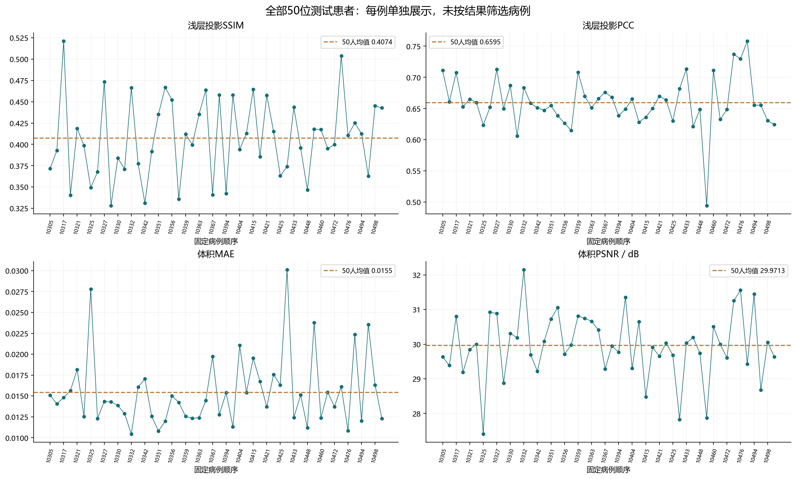

## 3. 与10例验证结果怎样对应

| 指标 | 验证集10人 | 测试集50人 | 测试−验证 |
| --- | --- | --- | --- |
| 体积 MAE ↓ | 0.014292 | 0.015458 | +0.001166 |
| 体积 MSE ↓ | 0.000974 | 0.001031 | +0.000058 |
| 体积 PSNR ↑ / dB | 30.211 | 29.971 | -0.240 |
| ILM–OPL SSIM ↑ | 0.4053 | 0.4074 | +0.0022 |
| ILM–OPL PCC ↑ | 0.6673 | 0.6595 | -0.0078 |

这是同一模型在不同患者群体上的描述性比较，不是配对试验。验证集曾用于选择best70，测试集只在冻结设置后评价；群体构成、病例难度和选模都会影响差值，不能仅由两个均值的差断言过拟合或改进原因。

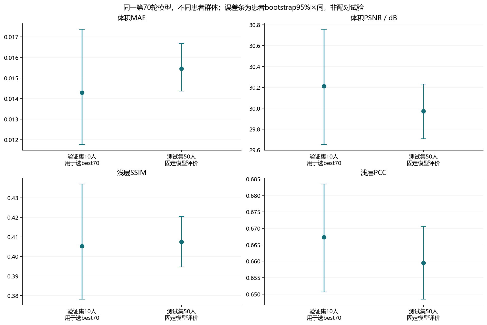

## 4. 强度、对比度与细节诊断

浅层预测均值的患者宏平均为 **0.1576**，真实均值为 **0.1876**，平均差为 **-0.0301**。其中 **8例预测均值高于GT、42例低于或等于GT**。不能对全部患者统一提亮后宣称结构问题已经解决。

全体积预测均值却为 **0.028800**，高于GT的 **0.021747**；预测>0.1的体素比例为 **9.99%**，GT为 **8.05%**。全体积偏亮与浅层投影偏暗可以同时存在，说明需要分区域检查背景、信号分布和对比度，而不能简单用全图亮度解释血管恢复。阈值占比不等于血管密度或血管召回率。

浅层投影空间标准差的宏平均比值（预测/GT）为 **0.701**。这是对比度诊断，不是毛细血管召回率或连通性得分。

预先固定GT>0.1的高强度区域平均占体素 **8.05%**。其MAE为 **0.062057**，其余区域为 **0.011378**，两者比值为 **5.45**。该区域贡献绝对误差的患者平均占比为 **33.83%**，平方误差占比为 **51.63%**。这些是实际分解，不能仅以背景体素多就断言背景主导了训练MSE或梯度；GT强度阈值也不是人工血管分割。

这里分解的是最终生成体积的重建误差，不能将其直接解释为训练时速度MSE的分布或梯度贡献。

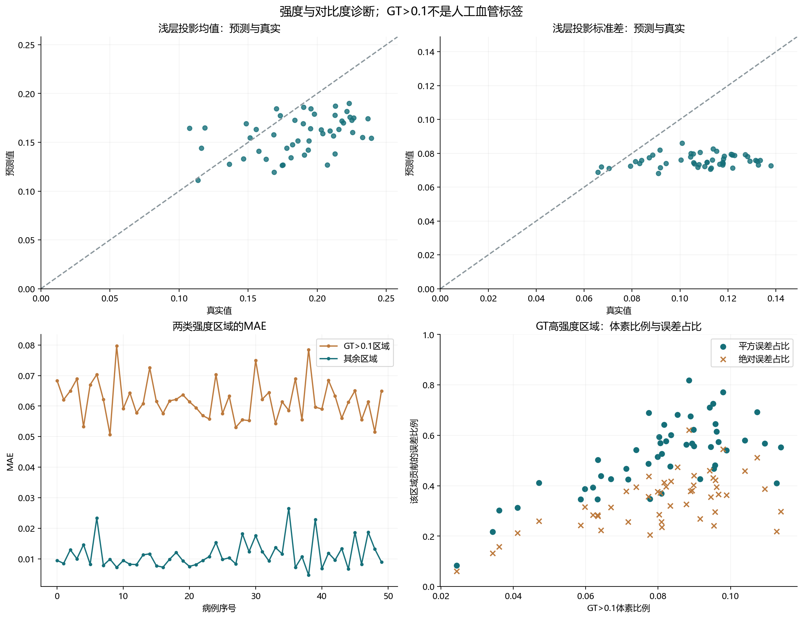

当前损失仍没有单独检查细血管分叉、断裂或层内投影的准确性。起点监督约束了从纯OCT起步的映射，但不等于增加真实血流信息或细血管专用监督。缺少输入线索时的MSE平均化、下采样/插值和窗口融合，都是需要独立对照才能分清贡献的解释候选；本报告不根据测试图调整这些设置。

对五页全部50例总览以及病例10305、10347、10430的完整图作目视核对：多数病例的大血管走向和中央低信号区可辨认，但细密网状纹理普遍更平滑、更弱，部分主干显得更粗或更亮。10317虽然浅层SSIM最高，仍不能据此认定细血管最准确；10430的全深度平均图明显偏亮，浅层预测均值却低于GT。10454的浅层预测均值高于GT，与多数病例的偏差方向相反。上述都是图像/数值差异描述，不是血管分割或病变诊断结论。

## 5. 为什么不能只看整体误差或平均投影SSIM

| 参照 | 体积MAE | PSNR/dB | 浅层SSIM |
| --- | --- | --- | --- |
| 固定第70轮模型 | 0.015458 | 29.971 | 0.4074 |
| 全零输出（数值健全性参照） | 0.021747 | 24.489 | 0.0043 |

模型相对全零参照的体积MAE变化为 **-28.9%**，PSNR变化 **+5.482 dB**。全零只是检查数值口径的参照，不是训练方法。

本次全深度均值投影SSIM为 **0.9123**，浅层最大投影SSIM为 **0.4074**。平均投影真实图最大值范围仅为 **0.0482–0.0919**，所有SSIM仍固定data_range=1、win_size=7。投影内容和动态范围不同，高均值投影SSIM不能替代细结构准确性，也不能直接等同于其他论文不同定义的SSIM。

## 6. 全部病例图像，无效果筛选

五页总览依照固定病例编号排序；每例左GT、右预测，浅层最大投影共享显示窗[0,0.5]。该窗口可能使较亮值饱和，仅影响展示，指标使用原始浮点值。

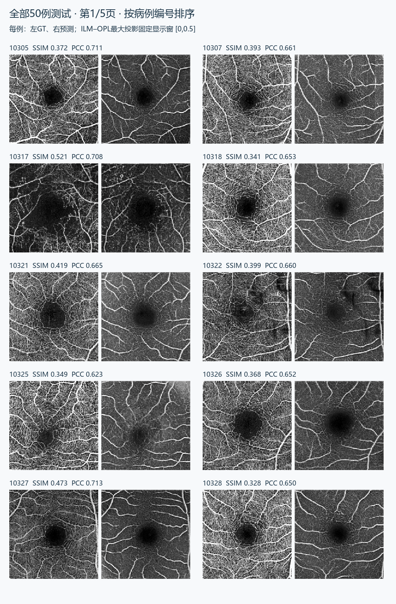

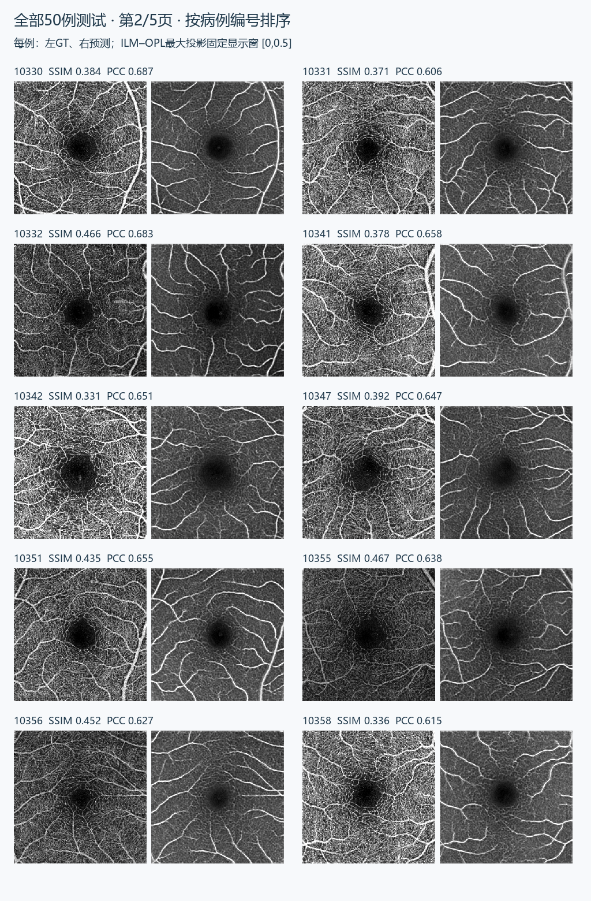

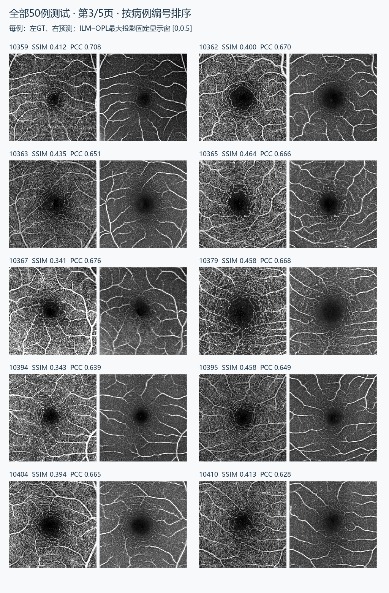

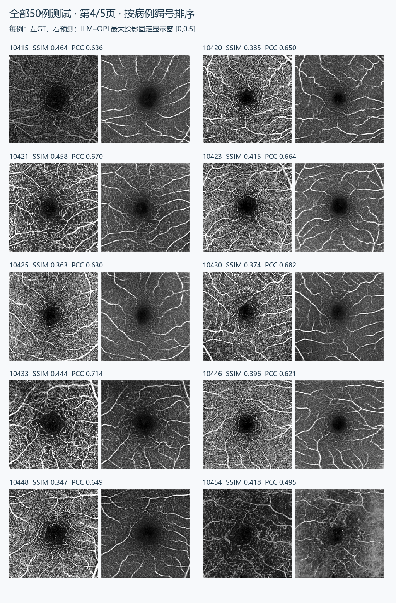

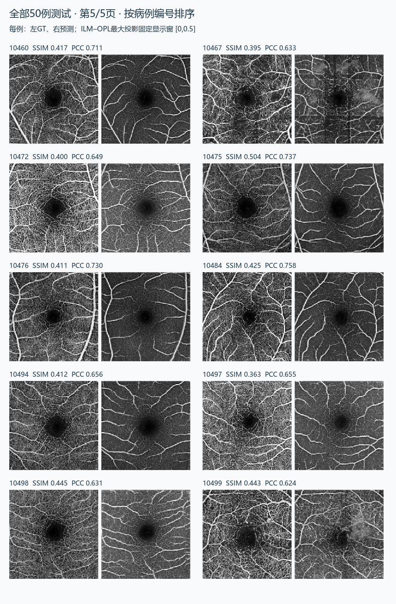

下面固定展示排序第1、25、50位患者，选择规则与模型效果无关；其余病例均可从下表打开完整图。

### 固定示例 10305

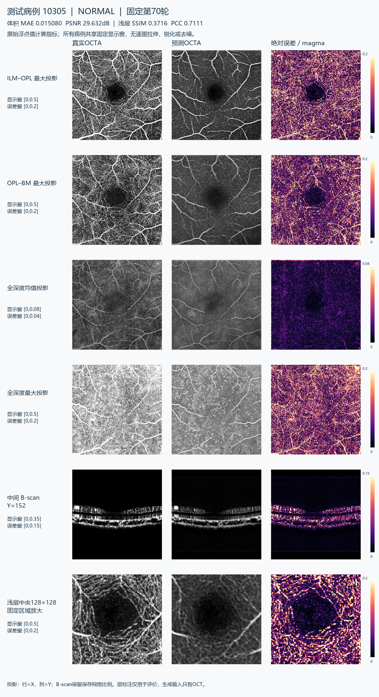

### 固定示例 10367

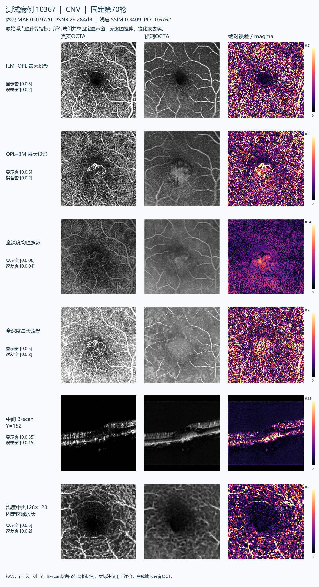

### 固定示例 10499

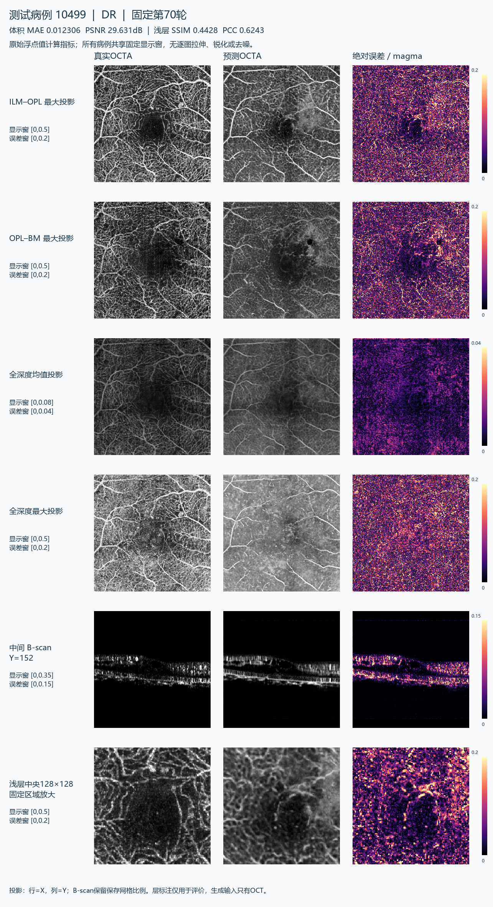

## 7. 病例差异与原始指标

浅层SSIM最低病例为 **10328（0.3284）**，最高为 **10317（0.5211）**；体积MAE最高为 **10430（0.030115）**。这里只描述本次固定模型的分布，没有据此选模型或调参。

| 病种字段 | 人数 | 体积MAE均值 | 浅层SSIM均值 | 浅层PCC均值 |
| --- | --- | --- | --- | --- |
| AMD | 1 | 0.027810 | 0.3492 | 0.6235 |
| CNV | 1 | 0.019720 | 0.3409 | 0.6762 |
| DR | 8 | 0.014965 | 0.4500 | 0.6470 |
| NORMAL | 40 | 0.015141 | 0.4020 | 0.6625 |

病种字段仅用于追溯和描述。小亚组尤其只有1–2人的情况，不支持病种性能排名或临床结论。

| 病例 | 病种 | 体积MAE | PSNR/dB | 浅层SSIM | 浅层PCC | 完整图 |
| --- | --- | --- | --- | --- | --- | --- |
| 10305 | NORMAL | 0.015080 | 29.632 | 0.3716 | 0.7111 | [查看](figures/10305_comparison.png) |
| 10307 | NORMAL | 0.014053 | 29.385 | 0.3930 | 0.6610 | [查看](figures/10307_comparison.png) |
| 10317 | DR | 0.014802 | 30.807 | 0.5211 | 0.7077 | [查看](figures/10317_comparison.png) |
| 10318 | NORMAL | 0.015645 | 29.186 | 0.3407 | 0.6529 | [查看](figures/10318_comparison.png) |
| 10321 | NORMAL | 0.018171 | 29.848 | 0.4187 | 0.6650 | [查看](figures/10321_comparison.png) |
| 10322 | NORMAL | 0.012540 | 30.000 | 0.3985 | 0.6596 | [查看](figures/10322_comparison.png) |
| 10325 | AMD | 0.027810 | 27.402 | 0.3492 | 0.6235 | [查看](figures/10325_comparison.png) |
| 10326 | NORMAL | 0.012298 | 30.921 | 0.3677 | 0.6521 | [查看](figures/10326_comparison.png) |
| 10327 | NORMAL | 0.014344 | 30.887 | 0.4735 | 0.7128 | [查看](figures/10327_comparison.png) |
| 10328 | NORMAL | 0.014303 | 28.874 | 0.3284 | 0.6497 | [查看](figures/10328_comparison.png) |
| 10330 | NORMAL | 0.013863 | 30.311 | 0.3840 | 0.6870 | [查看](figures/10330_comparison.png) |
| 10331 | NORMAL | 0.012890 | 30.185 | 0.3711 | 0.6058 | [查看](figures/10331_comparison.png) |
| 10332 | NORMAL | 0.010436 | 32.151 | 0.4664 | 0.6835 | [查看](figures/10332_comparison.png) |
| 10341 | NORMAL | 0.016071 | 29.693 | 0.3776 | 0.6584 | [查看](figures/10341_comparison.png) |
| 10342 | NORMAL | 0.017037 | 29.220 | 0.3311 | 0.6512 | [查看](figures/10342_comparison.png) |
| 10347 | NORMAL | 0.012556 | 30.086 | 0.3919 | 0.6470 | [查看](figures/10347_comparison.png) |
| 10351 | NORMAL | 0.010821 | 30.729 | 0.4353 | 0.6547 | [查看](figures/10351_comparison.png) |
| 10355 | NORMAL | 0.011973 | 31.056 | 0.4669 | 0.6385 | [查看](figures/10355_comparison.png) |
| 10356 | NORMAL | 0.015007 | 29.712 | 0.4522 | 0.6266 | [查看](figures/10356_comparison.png) |
| 10358 | NORMAL | 0.014240 | 29.974 | 0.3359 | 0.6147 | [查看](figures/10358_comparison.png) |
| 10359 | NORMAL | 0.012565 | 30.816 | 0.4122 | 0.7082 | [查看](figures/10359_comparison.png) |
| 10362 | NORMAL | 0.012332 | 30.746 | 0.3996 | 0.6696 | [查看](figures/10362_comparison.png) |
| 10363 | NORMAL | 0.012387 | 30.663 | 0.4354 | 0.6513 | [查看](figures/10363_comparison.png) |
| 10365 | DR | 0.014472 | 30.412 | 0.4639 | 0.6658 | [查看](figures/10365_comparison.png) |
| 10367 | CNV | 0.019720 | 29.284 | 0.3409 | 0.6762 | [查看](figures/10367_comparison.png) |
| 10379 | DR | 0.012785 | 29.947 | 0.4580 | 0.6679 | [查看](figures/10379_comparison.png) |
| 10394 | NORMAL | 0.015400 | 29.766 | 0.3426 | 0.6387 | [查看](figures/10394_comparison.png) |
| 10395 | NORMAL | 0.011313 | 31.351 | 0.4580 | 0.6492 | [查看](figures/10395_comparison.png) |
| 10404 | NORMAL | 0.021054 | 29.300 | 0.3940 | 0.6652 | [查看](figures/10404_comparison.png) |
| 10410 | NORMAL | 0.015421 | 30.650 | 0.4129 | 0.6281 | [查看](figures/10410_comparison.png) |
| 10415 | NORMAL | 0.019525 | 28.479 | 0.4644 | 0.6362 | [查看](figures/10415_comparison.png) |
| 10420 | NORMAL | 0.016737 | 29.908 | 0.3854 | 0.6501 | [查看](figures/10420_comparison.png) |
| 10421 | DR | 0.013698 | 29.659 | 0.4577 | 0.6697 | [查看](figures/10421_comparison.png) |
| 10423 | NORMAL | 0.017565 | 30.034 | 0.4153 | 0.6639 | [查看](figures/10423_comparison.png) |
| 10425 | NORMAL | 0.016316 | 29.684 | 0.3632 | 0.6300 | [查看](figures/10425_comparison.png) |
| 10430 | NORMAL | 0.030115 | 27.821 | 0.3739 | 0.6816 | [查看](figures/10430_comparison.png) |
| 10433 | DR | 0.012423 | 30.031 | 0.4437 | 0.7136 | [查看](figures/10433_comparison.png) |
| 10446 | NORMAL | 0.015125 | 30.193 | 0.3958 | 0.6212 | [查看](figures/10446_comparison.png) |
| 10448 | NORMAL | 0.011187 | 29.738 | 0.3468 | 0.6488 | [查看](figures/10448_comparison.png) |
| 10454 | DR | 0.023776 | 27.873 | 0.4178 | 0.4946 | [查看](figures/10454_comparison.png) |
| 10460 | NORMAL | 0.012374 | 30.505 | 0.4174 | 0.7113 | [查看](figures/10460_comparison.png) |
| 10467 | DR | 0.015456 | 29.995 | 0.3952 | 0.6327 | [查看](figures/10467_comparison.png) |
| 10472 | NORMAL | 0.013718 | 29.604 | 0.3996 | 0.6487 | [查看](figures/10472_comparison.png) |
| 10475 | NORMAL | 0.016103 | 31.255 | 0.5038 | 0.7370 | [查看](figures/10475_comparison.png) |
| 10476 | NORMAL | 0.010852 | 31.558 | 0.4105 | 0.7297 | [查看](figures/10476_comparison.png) |
| 10484 | NORMAL | 0.022356 | 29.423 | 0.4252 | 0.7581 | [查看](figures/10484_comparison.png) |
| 10494 | NORMAL | 0.012018 | 31.447 | 0.4124 | 0.6556 | [查看](figures/10494_comparison.png) |
| 10497 | NORMAL | 0.023558 | 28.680 | 0.3630 | 0.6552 | [查看](figures/10497_comparison.png) |
| 10498 | NORMAL | 0.016292 | 30.052 | 0.4451 | 0.6306 | [查看](figures/10498_comparison.png) |
| 10499 | DR | 0.012306 | 29.631 | 0.4428 | 0.6243 | [查看](figures/10499_comparison.png) |

## 8. 推理与来源核对

| 核对项目 | 结果 |
| --- | --- |
| 用于核对的病例 | 原验证病例10302；测试病例使用数=0 |
| 原最佳权重epoch | 70；没有扫描其他轮次 |
| GPU窗口批量 | 4 |
| 与exp003原始指标的最大绝对差 | 2.56e-06 |
| 原始投影像素最大绝对差 | 1.64e-06 |
| 预设容差 | 指标/投影均为1e-4；核对通过后才开始测试 |
| 病例设备分工 | cpu: 25例, gpu: 25例 |

逐窗口批量组织只改变计算调度，网络、窗口、时间点和累加顺序不变。GPU与CPU后端并非逐位等价，但在原验证病例上与原推理核对后才开始测试。测试期间不以任何测试患者做程序冒烟、性能模式选择、轮次选择或超参数决定。

本次运行跨越本机长时间暂停/等待与次日恢复；原CPU分工完成后，仅把未完成病例重新分配给空闲CPU，已完成结果保留，科学设置未改。逐病例seconds包含等待，不能作为纯GPU计算时间，也不能由本次不连续运行推算公平吞吐。服务器两张3090仍不可初始化，未用于本次生成。

分层投影复用原定义：标注为6层、MATLAB 1基的原640深度边界，Z256体素中心映射后在闭区间取ILM–OPL/OPL–BM最大值；FULL是256层算术均值，投影显示为XY。GT层标注用于预测与GT的相同事后投影，不进入生成模型。

## 9. 文件与解释边界

- [50例逐病例指标](per_case_metrics.csv)、[汇总及置信区间](metrics_summary.csv)、[逐病例来源与哈希](case_provenance.csv)。
- `results/case_views/`保留未拉伸二维数值及指定B-scan；`verification/`保留固定协议、验证核对、设备、来源和完整性记录。
- 原exp001/003代码和权重不覆盖，不制作交付压缩包；本次不增加训练、投影损失或模型修改。
- 这是既有固定测试划分下、当前固定模型的评价。项目历史上已经评价过旧模型的同一测试集，不能把它包装成全项目从未接触过的一次性外部盲测。
- 本次未使用人工细血管分割标签进行该类评价，不能给出有效的细血管Dice、召回率、clDice或临床安全性结论。图像更锐利或高频更多，也不等于新增纹理就是真实血管。
