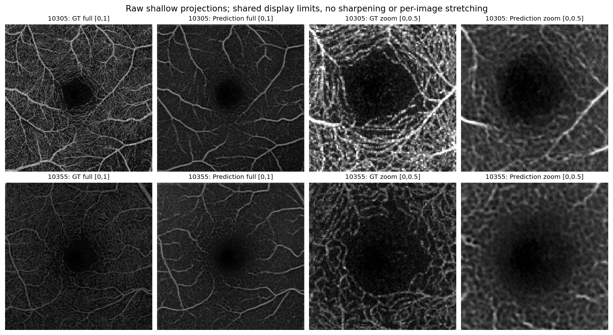
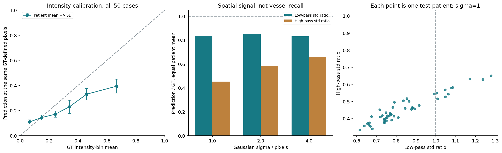

# 为什么主干较清楚，而细网偏弱、亮度出现分层

本分析回答对当前50例测试图像的观察。它是exp012对exp010已保存结果的事后分析；不修改原报告、权重、推理设置或预测，不重新训练，不根据测试结果调参。原始结果见[完整50例报告](test50/test_analysis.md)。

## 1. 图像和数值已经支持什么

病例10305的主干、分叉及中央低信号区可以辨认，但中央放大图的细密网络更平滑、更弱。10355的部分预测主干比GT更亮，而周围细网仍未等幅恢复。它们说明“主干变亮”与“细节恢复”可以分开变化。

10305是原固定测试列表的第一例；10355是明确用于解释局部偏亮的定性示例，并不代表全部患者。总体结论使用全部50例，未按效果挑选模型。



左两列采用同一[0,1]显示窗，避免[0,0.5]窗口的饱和影响对亮度的判断；右两列是固定中央128×128区域，GT/预测共享[0,0.5]。没有逐图拉伸、锐化或去噪。原报告58张图全部保留，见[原病例10305](test50/figures/10305_comparison.png)、[原病例10355](test50/figures/10355_comparison.png)。

对所有50对原始浮点浅层ILM–OPL最大投影，以固定σ=1、2、4像素的Gaussian分解作诊断：低频为Gaussian(I)，高频为I−Gaussian(I)。以下是先逐患者计算“预测标准差/GT标准差”，再等权平均。

| Gaussian σ / 像素 | 低频标准差比 | 高频标准差比 | 高频标准差比小于1的人数 |
| --- | --- | --- | --- |
| 1 | 0.8353 | 0.4529 | 50/50 |
| 2 | 0.8529 | 0.5819 | 50/50 |
| 4 | 0.8323 | 0.6606 | 50/50 |

**预测的细尺度信号比低频信号压低得更多。** 这些高频成分含血管边缘、细纹理，也含噪声；该统计不是细血管数量、召回率或真实口径测量。σ仅用于固定的事后统计，没有滤波或替换发布的预测。



## 2. 亮度不是简单地整体偏暗

以下分区完全由GT的原始浅层投影强度定义；每位患者先单独求均值，再作等权平均。所有分区均有50位患者的数据。

| GT强度区间 | GT均值 | 同位置预测均值 | 预测−GT |
| --- | --- | --- | --- |
| [0,0.1) | 0.0659 | 0.1098 | +0.0439 |
| [0.1,0.2) | 0.1478 | 0.1439 | −0.0039 |
| [0.2,0.3) | 0.2432 | 0.1712 | −0.0720 |
| [0.3,0.4) | 0.3407 | 0.2301 | −0.1106 |
| [0.4,0.6) | 0.4597 | 0.3304 | −0.1293 |
| [0.6,1] | 0.6677 | 0.3943 | −0.2735 |

这显示低强度位置被抬高、较强位置平均被压低，符合对比度收缩。低强度区不都是背景，高强度区也不都是大血管，因此不能将本表当作血管口径分层结果。

局部主干比GT亮与上表并不矛盾：上表按GT位置分组并跨患者平均，个别患者、局部主干、预测变宽及轻微错位都可能与整体趋势不同。原50例中有8例浅层均值高于GT，42例不高于GT；浅层预测均值总体0.1576、GT0.1876，而全体积均值反而是预测0.02880、GT0.02175。**单一全局提亮无法同时修复这些方向不同的偏差。**

## 3. 最有依据的机制候选：不确定的细结构被平方误差平均化

从代码可直接确认，当前方法是配对的确定性OCT→OCTA流：

```text
c = OCT，y = OCTA
x_t = (1-t)c + t*y
L_FM = mean((v_theta(x_t,t,c) - (y-c))^2)
```

一半更新精确取t=0，此时损失严格等价于：

```text
L_start = mean((c + v_theta(c,0,c) - y)^2)
```

在理想的平方误差回归下，给定同样输入时，最优预测是目标的条件均值。主干位置若比较稳定，平均后仍容易保留；细血管若有位置、形状或强度的不确定性，平均会把峰值摊开，形成较弱、较平的细结构。这是对当前确定性起点分支的数学解释，尚不是本模型因果归因的实验结论。

一个只说明机制的假设例子：在无法区分的输入条件下，某像素有30%概率出现强度0.6的细血管，其余为0，则平方误差的最优值是0.18。位置非常稳定的主干不必遭受同样程度的平均。这里的30%、0.6和0.18不是本次患者统计。

OCT提供结构条件，不能假设它对每个微血管位置和血流强度都有唯一而精确的对应线索。当前模型从OCT出发，没有随机初值或单独的血流观测；起点监督提高了对纯OCT起步状态的约束，并未为输入补充缺失的信息。

上述推理不意味着所有Flow Matching都必然模糊，也不证明完整八步ODE输出必定等于条件均值。一般FM训练回归的是条件路径速度场；本实验的纯OCT起点、配对路径和t=0采样方式，才是这里讨论的具体设计。[Flow Matching原论文](https://arxiv.org/abs/2210.02747)提供速度场回归的背景；[感知与失真权衡论文](https://arxiv.org/abs/1711.06077)说明较小重建失真与自然的视觉分布并不等价，不能据此推断锐化后的新纹理就是真实血管。

## 4. 模型和监督为什么可能扩大主干/细网的差别

代码事实及其可能影响如下；目前没有对应消融来确定各项贡献。

| 代码事实 | 可能影响 | 解释边界 |
| --- | --- | --- |
| 3次stride=2卷积，下采样后用三线性插值上采样 | 细窄峰、边界和微小位移更难稳定恢复，较大结构更容易保持 | 有全分辨率跳连，不能说下采样必然抹掉全部细节 |
| 基础通道16、约210万参数，裁块256×64×64 | 容量和局部上下文可能限制细网表征 | 不能仅凭这些数字判定容量不足；需相同训练预算对照 |
| 当前只有等权速度MSE，没有投影、血管分割、分叉或连通性损失 | 没有独立目标要求弱小结构保持正确的位置、强度与连接 | 不等于已证明背景主导训练；原报告的误差分解是最终重建误差，不是训练速度梯度 |
| Euler8、重叠窗口按Hann权重融合同一位置的速度预测 | 时间离散误差或窗口之间对弱结构意见不一致可能影响细节 | Hann是在同一位置融合多种上下文，不是对整图直接做空间模糊；预测一致时不会额外抹平结构 |
| 以验证集浅层SSIM选择best70 | 有助于总体浅层相似性，不直接选择细血管准确性 | 验证指标选择不是投影损失，未通过反向传播约束血管 |

原始模型和损失见[model.py](../source/training/fm3d/model.py)、[train_start.py](../source/training/fm3d/train_start.py)；逐步窗口融合见[inference_batched.py](../source/evaluation/inference_batched.py)。

## 5. 为什么部分主干会比GT更亮

主干位置比较容易预测，并不表示强度已校准。当前没有病例级局部强度校准或专门的主干/细网对比约束，固定除以255也只是单位换算。网络可能学到比某一病例GT更强或更宽的稳定主干，同时仍将不确定的细网压成较弱纹理。

最大投影会突出层内峰值，局部高值、预测变宽和层内深度分布偏差可能强化视觉上的主干亮度。原报告预测和GT使用相同层标注、相同显示窗；不能把这次差异简单归因于对GT和预测做了不同拉伸。局部过亮、全体积低强度位置抬高，以及浅层细网偏弱，应分别检查。

这解释了该现象为什么在机制上合理。它不证明目前已分离出强度误标、投影偏差、条件不充分或网络容量的各自比例。

## 6. 哪些检查能分清原因

后续新实验应在训练/验证集上设计并确定设置，再冻结测试协议；本次没有启动这些实验。

1. 用验证集检查更细的ODE步长，判断细节差异有多少来自数值离散，保留完全相同的模型权重和显示方式。
2. 在相同网络、更新次数和数据划分下，对照多尺度结构/梯度监督及明确的细血管目标；如使用血管标签或权重，只从训练集取得，参数在验证集决定。
3. 单独检验高分辨率表征、模型容量或起点/随机性设计，避免同时改动多项后无法归因。
4. 若要正式声称“细血管更准确”，需要独立的细血管标注、预先固定的评价方法和连接性/假阳性检查；新增高频、锐度或更高投影SSIM均不能单独替代该证据。

## 7. 复算与边界

新增统计完整数据见[逐病例亮度分区](intensity_bins_per_case.csv)、[逐病例尺度统计](scale_per_case.csv)、[汇总JSON](scale_summary.json)。[分析代码](../analyze_scales.py)只读取50对保存的二维浮点投影，没有读取新患者、运行模型或改变预测。

本分析没有血管口径真值、细血管分割或临床结局标签，因此不报告细血管Dice、召回率、clDice或临床有效性。本文明确区分图像/数值观察、代码事实、数学解释与尚未验证的机制候选。
